# Revisión de tomas rechazadas — bible-long-001

Aprobadas por el control: 41 de 76 escenas. Rechazadas: 35.

Para aprobar una toma, indicá su número de escena y su intento (o el SHA-256). Las que no apruebes se unen a la escena vecina.

## 001 · `opening-shot-0`

**Narración:** Imagine throwing a stone into a dark cave in the desert,

**Escena pedida:** A low-angle view from inside a dark, jagged cave looking toward the blinding bright desert entrance, a small stone is mid-air just entering the frame.

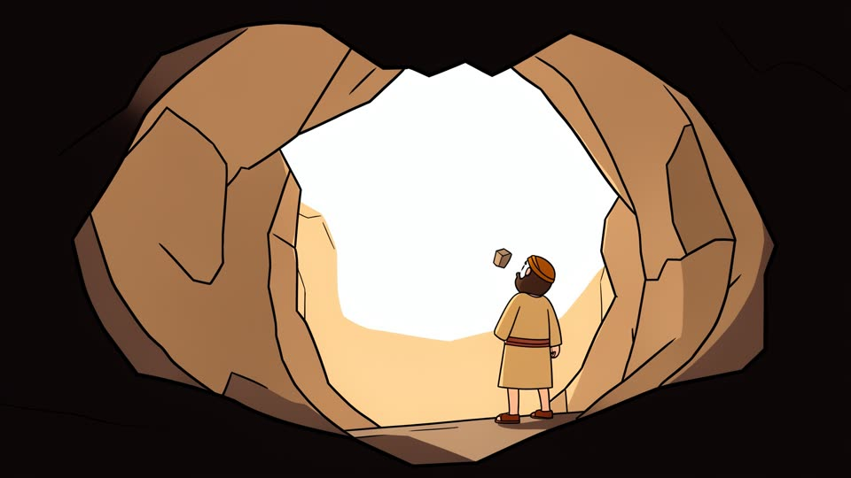

- Intento: `opening-shot-0-p3` · SHA-256 `72d12eb16276d4471199e6ec5b9ea3be9ed8fb6e2c91fe5c22e508c6e0139ff0`
- Fallas: requiredConcept
- Detalle: The concept requested a view from inside a cave looking out with a stone mid-air, but the generated image includes the recurring channel character 'Eli' standing in the cave, which was not requested in the specific concept provided. / The stone appears to be floating in mid-air near the character's head rather than appearing as a stone being thrown into the cave from the outside.

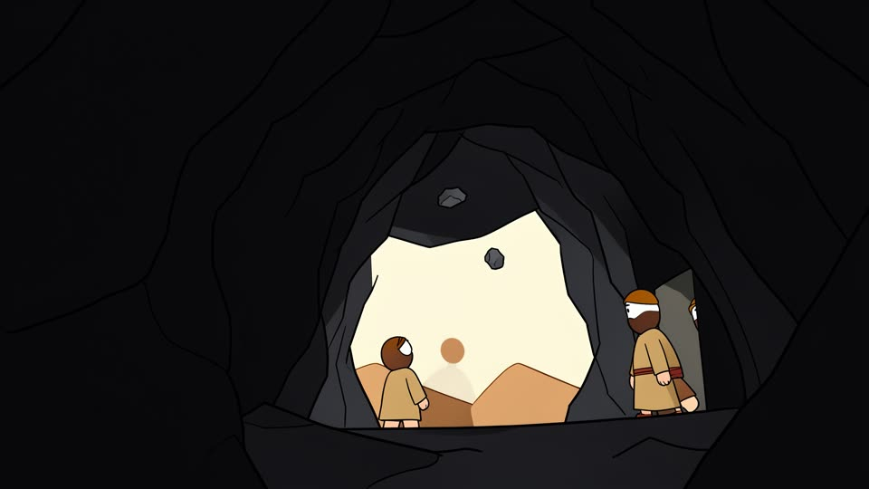

- Intento: `opening-shot-0-p4` · SHA-256 `5f855d98ef19b1d49b98cf452f3594f01b6fc998e30c4293d68f30f1e4b20690`
- Fallas: requiredConcept
- Detalle: Image includes extra unrequested characters not present in the concept narration. / The concept requested a low-angle view from inside a cave with a stone mid-air, but the generated image adds two characters in the foreground, violating the density guidelines and narrative focus.

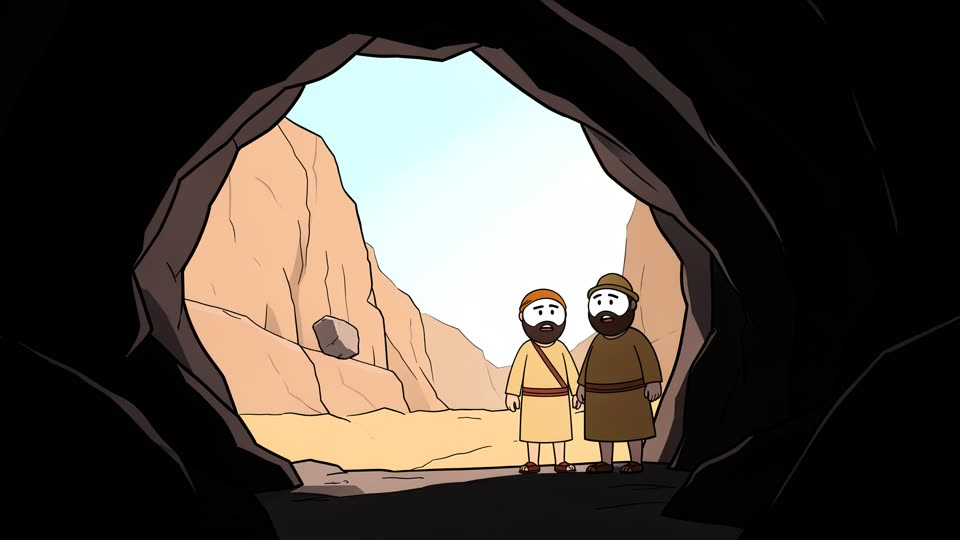

- Intento: `opening-shot-0-p5` · SHA-256 `bdc8c1ae03f139484dd8681c7e81da407d76e9ad15e76e2891496c2fcf937b08`
- Fallas: requiredConcept
- Detalle: The generated image depicts two characters standing outside/at the entrance of the cave, whereas the concept specifically requested a low-angle view from inside looking out, with a stone mid-air entering the frame. / The narration and concept focus on a stone being thrown into a cave; the presence of two characters standing at the entrance diverts from the described action.

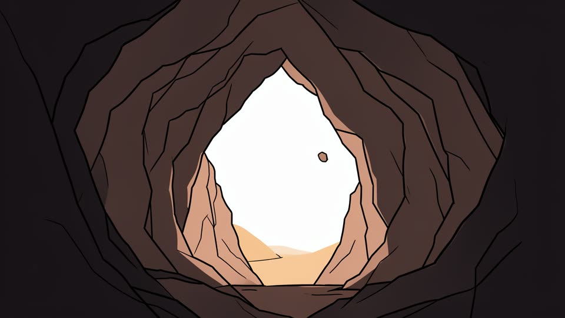

- Intento: `opening-shot-0-regen1-p3` · SHA-256 `25783aa06df5e99a67437889e7e50665edbcfbdd3fc9c45db972d496a8581ef2`
- Fallas: requiredConcept
- Detalle: The generated image depicts a cave, but the requested narrative beat was specifically to show the action of a stone being thrown into a cave. The resulting image shows a static, empty cave with a stone floating in the air, which fails to visually represent the narrative action of 'throwing' or the presence of a person or agent associated with the action.

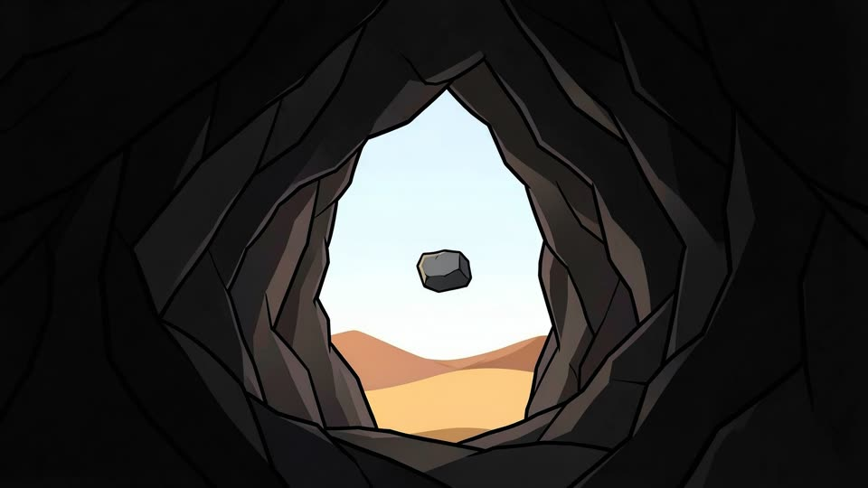

- Intento: `opening-shot-0-regen1-p4` · SHA-256 `bb15babc1979d6c439bb8f251023be5c3d81786a556320d99128fb3242742f3c`
- Fallas: requiredConcept
- Detalle: The concept required a low-angle shot from inside a cave. While the art style matches, the image fails to represent the 'small stone is mid-air' beat accurately, as the stone appears static and floating in a way that does not clearly convey the action of 'throwing a stone into a dark cave'.

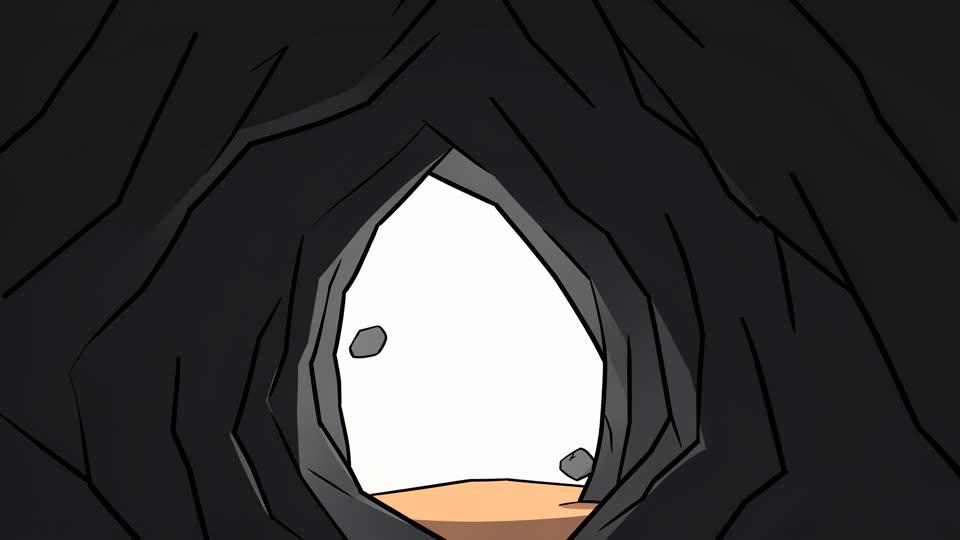

- Intento: `opening-shot-0-regen1-p5` · SHA-256 `40596ed0427fa98ef42f63674d98d88e68e6196b1a7042fc58821318fe7ba55b`
- Fallas: correctStyle
- Detalle: The style of the cave in image 2 is noticeably different from the character-focused style in image 1. It lacks the 'simple expressive round-head' aesthetic context entirely, appearing more like a generic cartoon background. / The line work and flat color treatment in the cave scene do not align with the specific aesthetic grammar (flat warm colours, clean outlines) established by the Eli reference.

## 003 · `opening-shot-2`

**Narración:** to the most common account, that is how it began,

**Escena pedida:** Eli, a young Bedouin shepherd, stands at the edge of a cliff, hand still outstretched from the throw, looking down with a mix of surprise and caution.

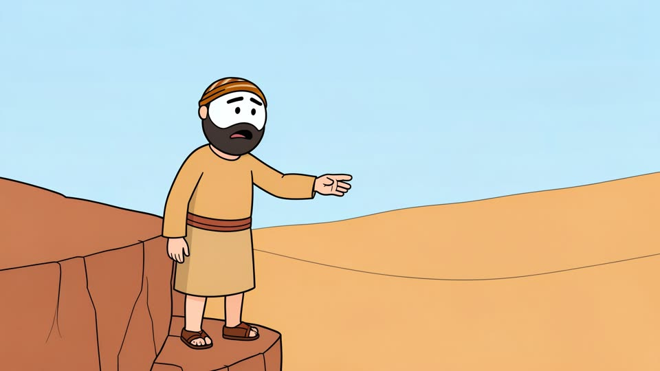

- Intento: `opening-shot-2-p3` · SHA-256 `3c40367a001dd2403e42672e61448b760b58bb19184e6c490ea22536bf474415`
- Fallas: requiredConcept
- Detalle: The character pose does not match the concept: the prompt specifies 'hand still outstretched from the throw, looking down', but the character in the image is standing at the cliff edge with his hand outstretched, yet his facial expression is neutral/static rather than showing 'surprise and caution', and he is not looking down.

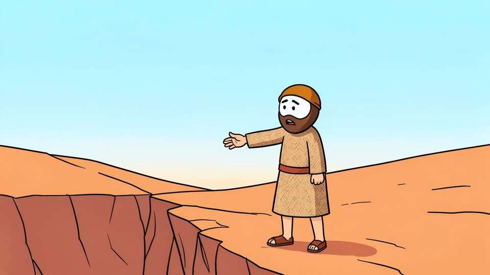

- Intento: `opening-shot-2-p4` · SHA-256 `c501a0e1f3864762593a9be8ad11b27287d51d247a1edd527f45a9a5bc2285b1`
- Fallas: adultAnatomy
- Detalle: The character hand shows an incorrect anatomical structure (extra fingers/hand distortion) on the outstretched arm.

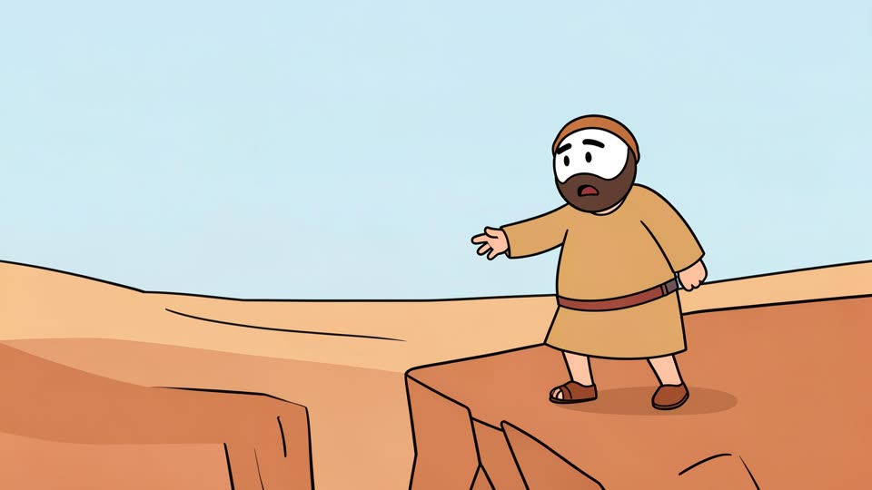

- Intento: `opening-shot-2-p5` · SHA-256 `0b79a4331ead740ff3a29d23c67daab75cc32ccf7d1aba56a012af408810e0eb`
- Fallas: adultAnatomy
- Detalle: The character's hand is anatomically malformed with an unnatural joint and finger-like protrusions that lack structural coherence, failing the adultAnatomyCorrect criteria.

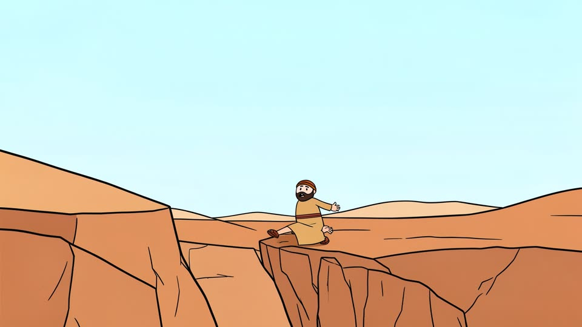

- Intento: `opening-shot-2-regen1-p3` · SHA-256 `d6384a41e37d4cccbad67081104cf780f043e51508be54967c8cf6dc9e05717f`
- Fallas: adultAnatomy
- Detalle: The character anatomy is structurally broken; he appears to have a third leg or limb extending from his hip/back area while seated, and the positioning of his limbs is physically impossible.

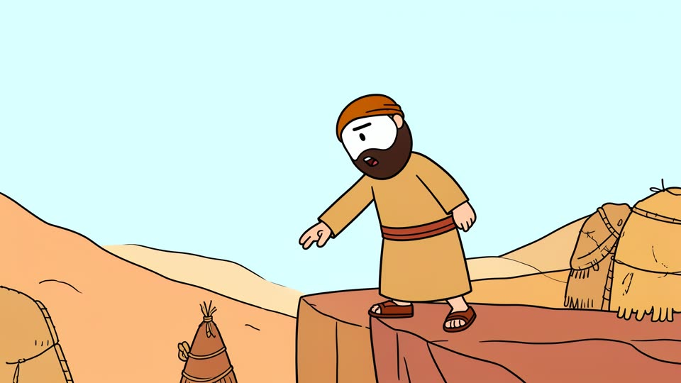

- Intento: `opening-shot-2-regen1-p4` · SHA-256 `07e289e1c11fdde79982102392c871547592730d8239fe308ced0ea8ef084427`
- Fallas: adultAnatomy
- Detalle: Serious anatomical defect in Eli's left hand (the one outstretched): the thumb is positioned on the wrong side relative to the palm/palm curve, resulting in a distorted hand shape.

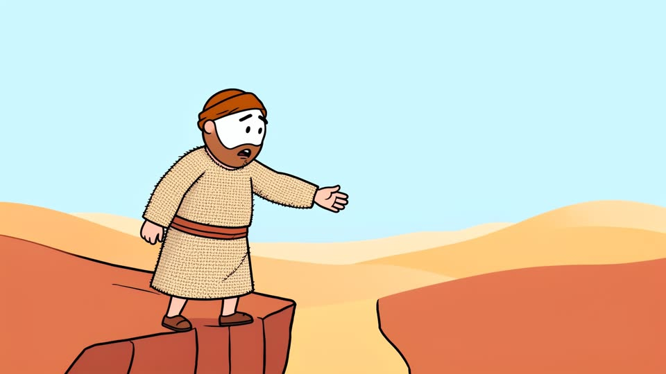

- Intento: `opening-shot-2-regen1-p5` · SHA-256 `85fe4d3b8c650e0a12f1d980301a791cd20a9d070e1168b34a87885b446f57cd`
- Fallas: adultAnatomy
- Detalle: The character design in image 2 deviates from the reference Eli (image 1) regarding the face mask/beard shape and the texture of the tunic. / The character's hand appears to have an incorrect number of digits (six fingers), which constitutes an anatomical defect.

## 005 · `opening-shot-4`

**Narración:** A young shepherd was searching for a lost goat in the cliffs

**Escena pedida:** A distant shot of Eli navigating a steep, rocky mountain path, holding a simple wooden staff, scanning the terrain for a missing goat.

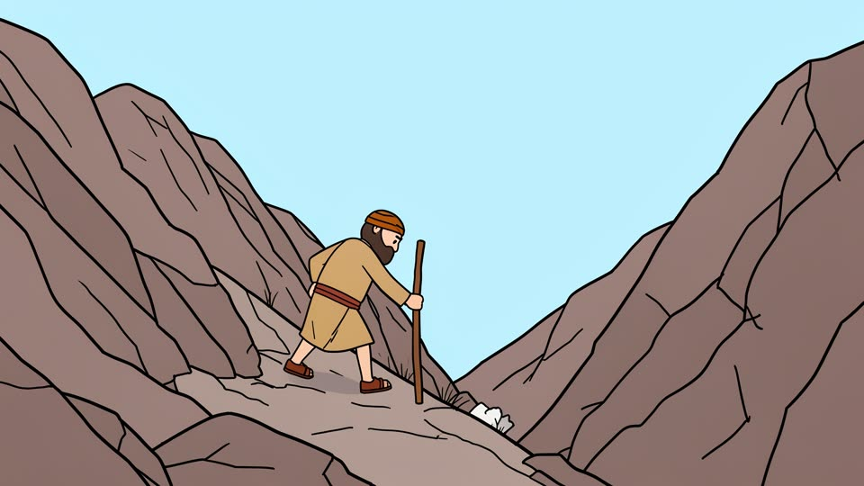

- Intento: `opening-shot-4-p3` · SHA-256 `2021310a92f6b6c9310a0f0aa91fb8e8e3f034065f350734c08d11adbda36cfd`
- Fallas: requiredConcept
- Detalle: The concept required the shepherd to be scanning for a missing goat, but no goat is visible in the frame, failing the narrative requirement to show the context of the search.

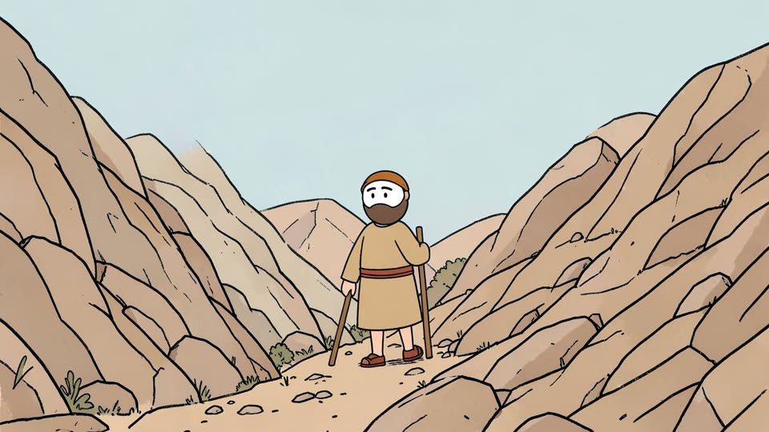

- Intento: `opening-shot-4-p4` · SHA-256 `16f700c21b6fffb9b35b4acc1f25c8a977cf4821e5791d4e06ead361ba9281bf`
- Fallas: adultAnatomy
- Detalle: The character is depicted with two staffs, one of which appears to be phasing through or emerging from his body/arm, resulting in a structural anatomy error where the staff is not held by a hand but is merged with the torso/arm area.

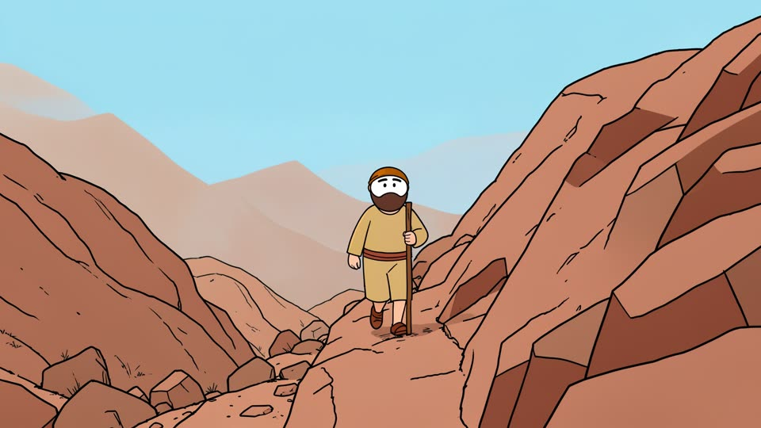

- Intento: `opening-shot-4-regen1-p4` · SHA-256 `1fee1242b325b103840d54865b6b511fa63a60efbe70e63405535bdefd9b4bed`
- Fallas: requiredConcept
- Detalle: The character Eli is not drawn as specified in input_image_0; specifically, he is missing his beard and the facial features are simplified beyond the established style of the character. / The concept requested a search for a lost goat, but no goat is present in the image, failing the NARRATIVE_SUFFICIENCY check.

## 006 · `opening-shot-5`

**Narración:** above the Dead Sea. He threw a stone into a

**Escena pedida:** Eli standing on a high limestone precipice, his arm in motion, tossing a small rock toward a dark, narrow fissure in the cliff face below.

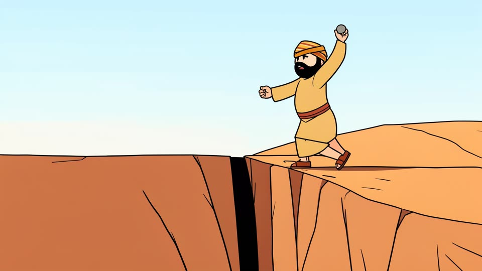

- Intento: `opening-shot-5-p3` · SHA-256 `f447fbb0b703ea49672bbb34847e2bde2fb975df8444b7201db0045a47702f8b`
- Fallas: adultAnatomy
- Detalle: serious anatomy defect: left leg is distorted/disconnected at the hip area to support the pose

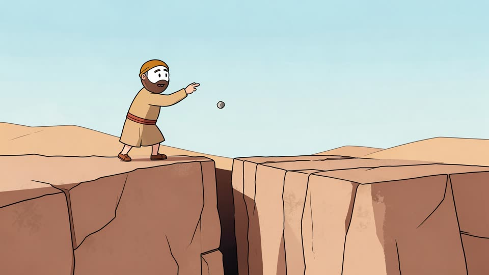

- Intento: `opening-shot-5-p4` · SHA-256 `273a11885b012e8e672e06bd90f75afb55d9f50d530d8a716230d291e4713303`
- Fallas: requiredConcept
- Detalle: The generated image depicts Eli standing on a ledge throwing a stone, but fails to show the requested 'cliff drop-off' or the 'dark, narrow fissure in the cliff face below', showing instead a small gap between two flat landmasses. / The character action is shown, but the environmental scale and specific narrative elements (the fissure/Dead Sea context) are missing, resulting in low narrative sufficiency.

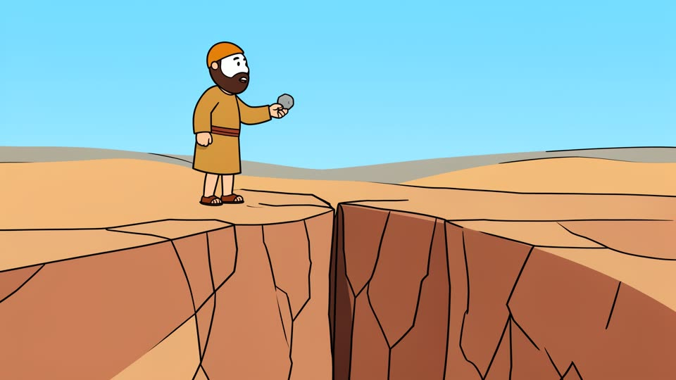

- Intento: `opening-shot-5-p5` · SHA-256 `cb9c7bdcbf00e5d48c2e79060d8d72c45c9a6484217513fcf9a306740f38614e`
- Fallas: requiredConcept
- Detalle: The narrative beat requires Eli to be throwing a stone into a fissure; the character is merely holding a stone while standing still, failing to convey the motion or action specified in the prompt.

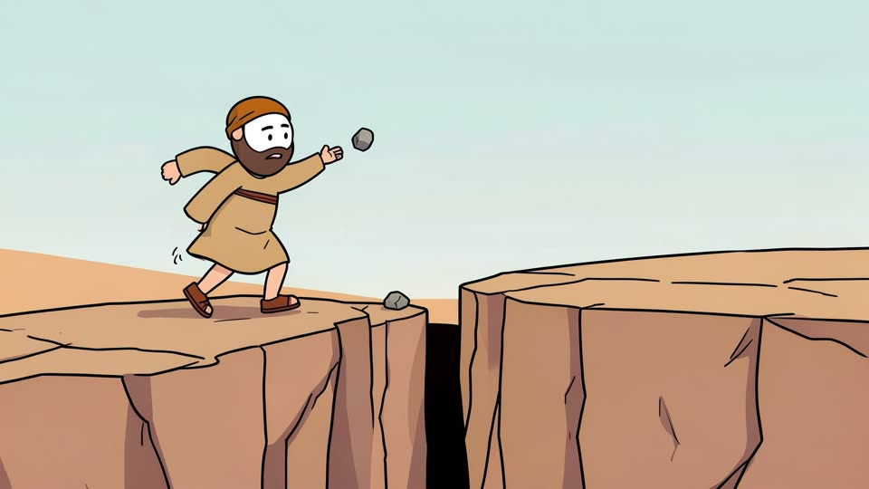

- Intento: `opening-shot-5-regen1-p3` · SHA-256 `13d79334c4a74abfc634a196bb16d018b528c1e4d7b4cabf48719a953ea93b4a`
- Fallas: adultAnatomy, correctStyle
- Detalle: Character design mismatch: Eli in the second image significantly deviates from the reference character sheet (Eli in the reference has a distinct round-head with simple dot-eyes, a fuller beard, and a specific striped head cloth, whereas the second image depicts a differently shaped head, different eye style, and a plain-colored cap). / Anatomical concerns: The limb placement and character proportions deviate from the established 'simple cartoon' style seen in the reference, appearing slightly more complex and less consistent with the 'Eli' character asset.

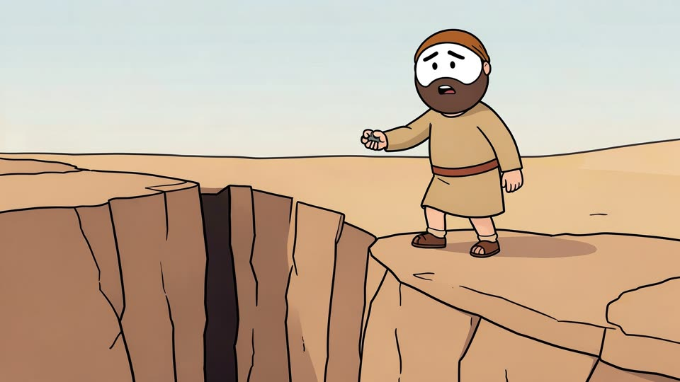

- Intento: `opening-shot-5-regen1-p4` · SHA-256 `ab5cfe1767e7062b9e780a748ad74dc3eb5f730432840378002cc45265d8c156`
- Fallas: correctStyle
- Detalle: Eli's head cloth pattern (plain vs striped) inconsistent with reference / Head shape and facial proportions differ slightly from reference Eli

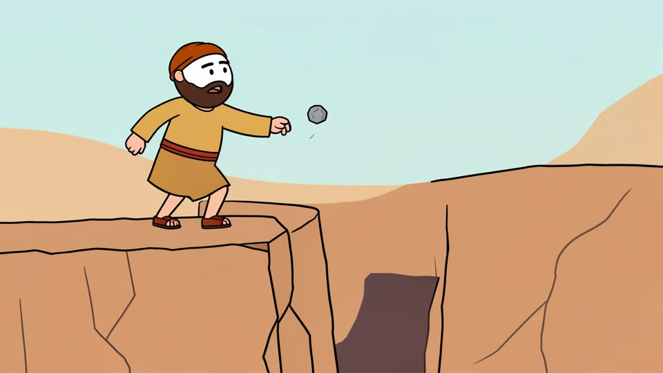

- Intento: `opening-shot-5-regen1-p5` · SHA-256 `2708a5cec6c4687b693108eed2a6e218ae15aec15ffe193e6917729217ba2066`
- Fallas: adultAnatomy
- Detalle: The character's hand is depicted with an anatomical configuration that appears to be a back-of-hand thumb orientation relative to the palm, creating a slightly malformed look.

## 008 · `opening-shot-7`

**Narración:** later climbed in with his cousins. Inside stood

**Escena pedida:** Three young men inside a cramped, dark cavern. Sunlight filters through a narrow entrance above, illuminating dust motes. One figure holds a small oil lamp, staring in awe.

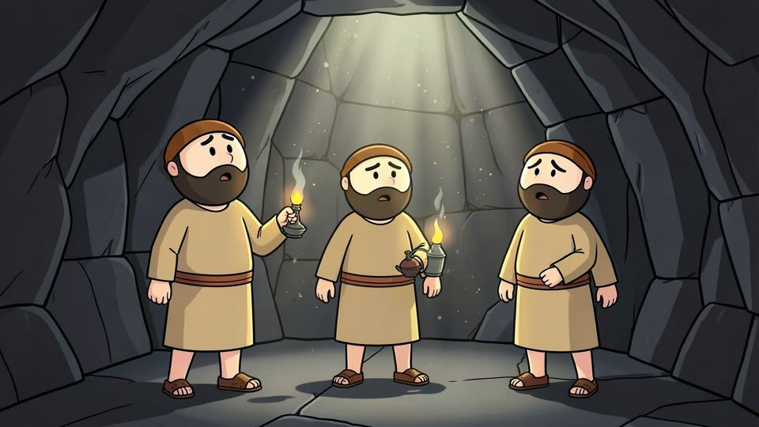

- Intento: `opening-shot-7-p3` · SHA-256 `ee667b3e3cfe54e3364edf901f428f07d728cf8a3ddf9cc5eaf3826232fb0f3c`
- Fallas: correctStyle
- Detalle: Image contains three characters instead of a single primary subject. / Density is too high compared to the reference style (which features one primary subject with minimal background). / The style utilizes gradients and shading not present in the flat-colour reference. / The background is more complex (shaded cave walls) than the simple reference background.

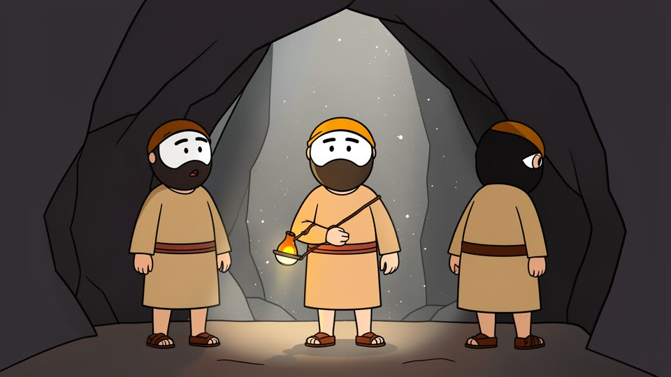

- Intento: `opening-shot-7-p5` · SHA-256 `0864ce3c35a8fc7a1dc20e9f964f6a665f63af3f0673fe3f4524659eed3ee0bd`
- Fallas: adultAnatomy
- Detalle: The generated image contains three characters, which functions as a de facto character sheet/repetition of poses rather than a single cohesive scene. / The character on the right has an impossible anatomical defect: an eye visible on the side of the head/face profile. / The character in the center is holding the oil lamp in a structurally nonsensical way, appearing to be tethered by a stick/line that is not properly integrated into the hand anatomy.

## 011 · `opening-shot-10`

**Narración:** wrapped in linen. They did not know it yet, but they had found some of the oldest surviving

**Escena pedida:** Close-up of a hand carefully touching a fragment of ancient, fragile linen fabric wrapped around a dark, cylindrical leather scroll segment.

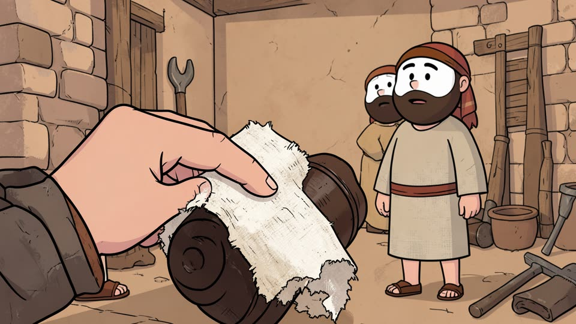

- Intento: `opening-shot-10-p3` · SHA-256 `a1e528b0cdfb6ff1eb2cba16bf4eab477f034f2206b71798fb6e64c19c7771f5`
- Fallas: requiredConcept
- Detalle: The generated image shows two characters in the background when the concept strictly requested a close-up of a hand touching a scroll fragment; the inclusion of these characters increases density beyond the requested scope. / The narration beat regarding 'oldest surviving linen' is partially obscured by the inclusion of the characters.

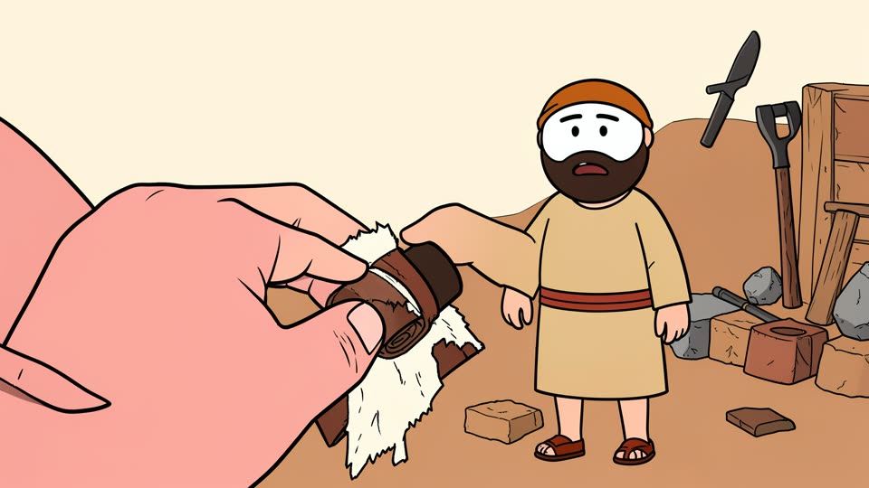

- Intento: `opening-shot-10-p4` · SHA-256 `9faaa9440c4942e1ec17915aca85e3132b4b0bc033c2528654092ced461c3100`
- Fallas: adultAnatomy, requiredConcept
- Detalle: The generated image depicts Eli standing to the side rather than the requested close-up focus on the hands and fabric. / The scale of the character Eli relative to the hand is disproportionate and confusing, making it look like Eli is a miniature figure in the scene rather than a close-up interaction.

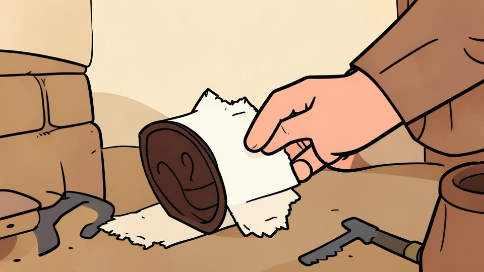

- Intento: `opening-shot-10-regen1-p3` · SHA-256 `82cac4dca456576022c85ff2692ffcc1e039853791164d2e805a397fa417dd6a`
- Fallas: adultAnatomy, historicalAccuracy, correctProp
- Detalle: Image contains two modern metal tools (a handsaw and a T-shaped metal tool) which are historically inaccurate for an ancient Judean scroll discovery scene. / The hand anatomy is slightly distorted, showing an unusual thumb/finger junction that borders on structural breakage.

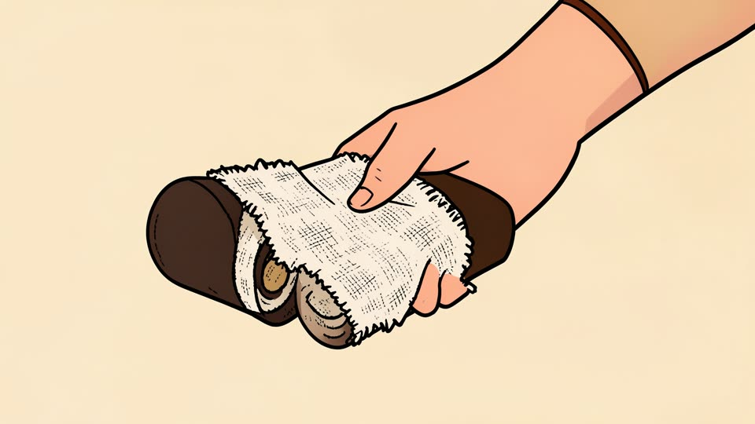

- Intento: `opening-shot-10-regen1-p4` · SHA-256 `c7ad286da48029cefed61676bed6047da9f62fe172c0d085e066a105d262239c`
- Fallas: adultAnatomy, requiredConcept
- Detalle: The generated image is a hand holding a scroll fragment, but it is not a 'Close-up of a hand carefully touching' as requested; the finger structure is malformed.

## 015 · `mystery-1-shot-2`

**Narración:** money, and from there they passed from hand to hand. Four of

**Escena pedida:** Close-up view of hands passing a dusty, leather-wrapped scroll between two men. The room is shadowy, with sunlight filtering through a high window, suggesting the transition of the scrolls through various middleman dealers.

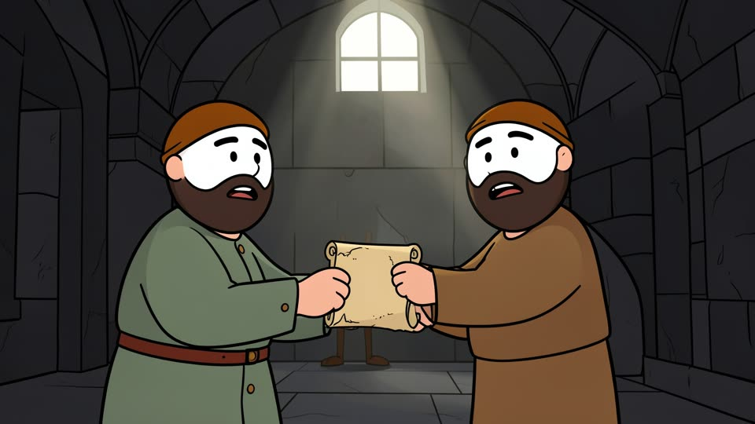

- Intento: `mystery-1-shot-2-p5` · SHA-256 `fe6dc9bef9a90284ce3911aa32d476afd72679c5aad486d7828b12278664c4ee`
- Fallas: adultAnatomy
- Detalle: Anatomical failure: The middleman/dealer is holding a scroll, but there is a floating pair of legs visible in the background between the two characters without an attached torso.

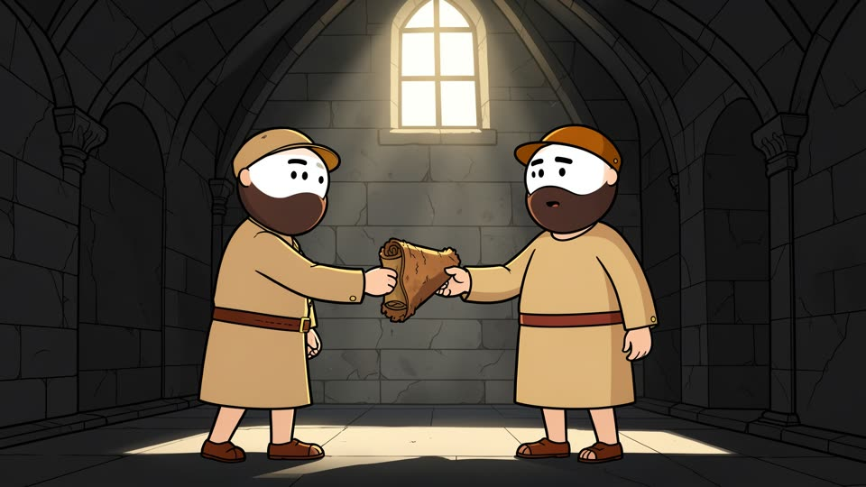

- Intento: `mystery-1-shot-2-regen1-p5` · SHA-256 `6f4a0d399bc90b40abaa073b2a71124c5ebc90eacf92d0d62268d4a9d4293a80`
- Fallas: adultAnatomy
- Detalle: The generated image depicts two characters holding a scroll, but the prompt specified an interior of a stone building. While the architecture is present, the characters are dressed in 1940s-style peaked caps and collared tunics, which might be perceived as a minor anachronism for the context if strictly historical, though the style remains consistent with the requested cartoon look.

## 018 · `mystery-1-shot-5`

**Narración:** Remember those four scrolls, because they will come back later in this story. When scholars

**Escena pedida:** Eli sits on a woven mat in a stone room, lit only by a small terracotta oil lamp. He is hunched over, carefully using a reed pen to write Hebrew characters onto a prepared piece of animal skin, his focus absolute.

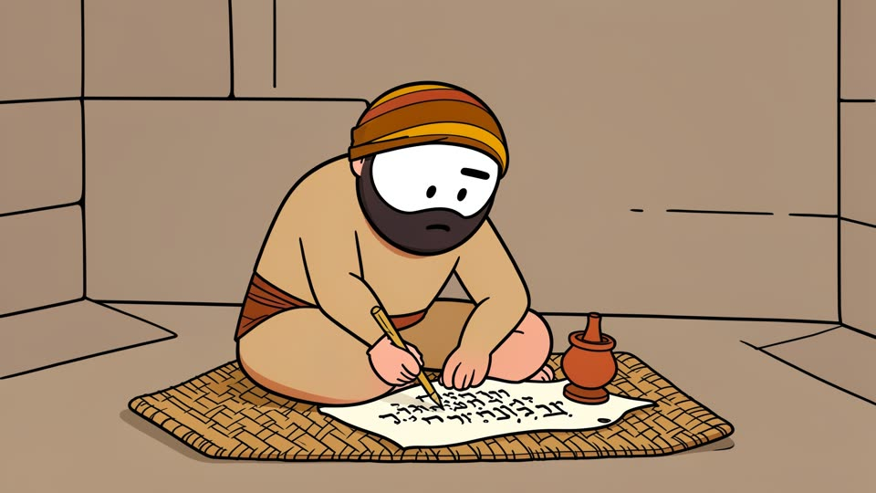

- Intento: `mystery-1-shot-5-p3` · SHA-256 `3b0fa3d4ddf00f8c5760ad866b0c5e62d064dc84426080dd92da0ef3046748c5`
- Fallas: adultAnatomy
- Detalle: The character's arm/hand structure appears merged or distorted where the hand meets the reed pen, making it difficult to discern the anatomy of the wrist and fingers. / The anatomical depiction of the folded legs is ambiguous and partially merged with the torso/waist area, failing to clearly define lower limb joints.

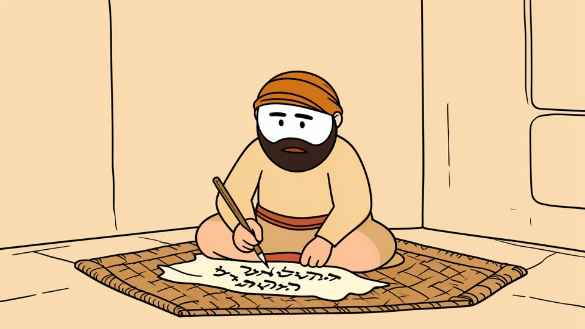

- Intento: `mystery-1-shot-5-p4` · SHA-256 `aa7367dbd69dc214e9e005b3a8c3b91336c926c2af0b14cac5de3d406d7c7cad`
- Fallas: adultAnatomy
- Detalle: The character's left arm appears to be awkwardly merged or disproportionately foreshortened behind his body, failing to clearly show the arm structure while writing.

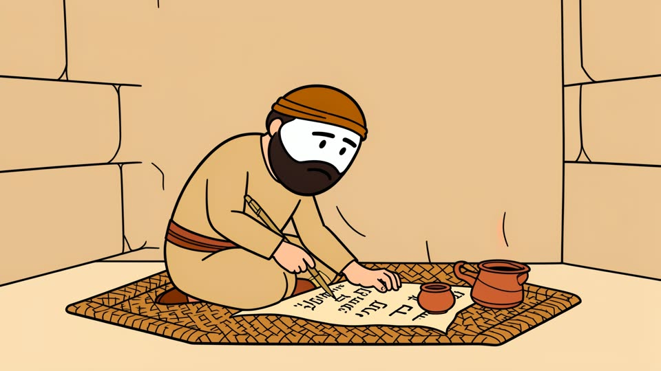

- Intento: `mystery-1-shot-5-regen1-p3` · SHA-256 `1527cd0330c0d7a9f8d557aa41efa7d39af98ca21b2edef5583576a4c1d2decf`
- Fallas: adultAnatomy
- Detalle: The character is missing legs entirely, and the lower body anatomy is merged/undefined where he sits on the mat, failing to show the sitting posture clearly. / Anatomical structural error: the connection between the torso and the legs (which are non-existent/hidden) is visually disjointed in a way that breaks the character's volume.

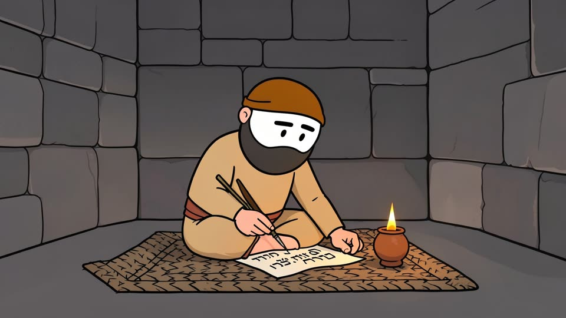

- Intento: `mystery-1-shot-5-regen1-p4` · SHA-256 `a82ca9495ee5664d1aa330783001bdd7fec8f345038348ea28fa09e652013092`
- Fallas: adultAnatomy
- Detalle: The character is holding a reed pen incorrectly; the way the hand is drawn merging with the pen suggests a functional hand defect / The hand drawing the characters is anatomically malformed with an unclear finger structure

## 021 · `mystery-1-shot-8`

**Narración:** with radiocarbon dating. Most scholars now date the scrolls from about three

**Escena pedida:** A pair of modern gloved hands carefully handles a small, crumbly sample from a scroll fragment, placing it onto a clean scale in a bright, sterile, modern lab environment.

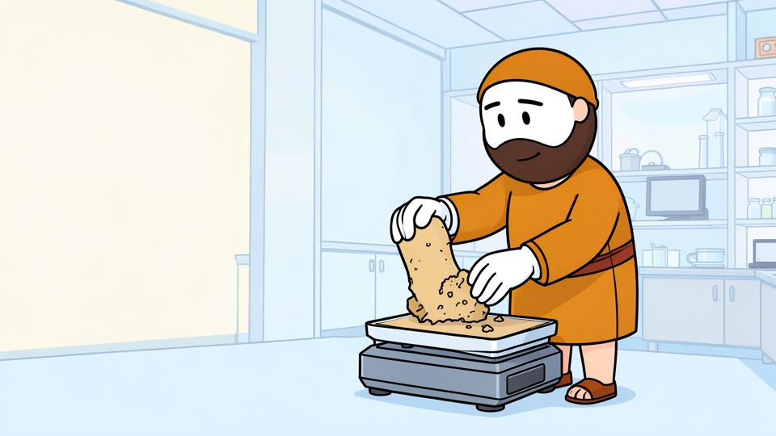

- Intento: `mystery-1-shot-8-p3` · SHA-256 `5820f8da5d32a9380a47faa1112fbededec5e84eeda5aea06ad73b0741a71855`
- Fallas: correctStyle
- Detalle: Character design deviates from reference Eli: mismatched head color, different clothing style, and lacks the signature striped head cloth. / Density higher than target reference: includes detailed lab equipment background not present in reference grammar.

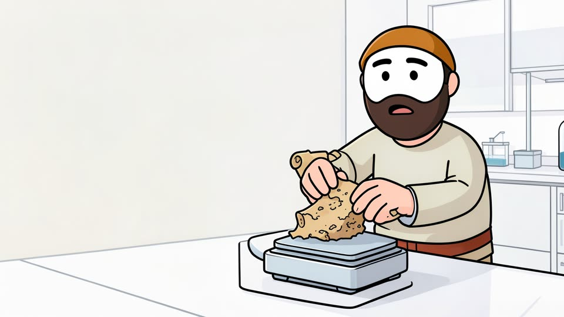

- Intento: `mystery-1-shot-8-p4` · SHA-256 `23a9262c446c3c6994020cf30743a52cff1d06b47653c34bca732c7a3ae72372`
- Fallas: adultAnatomy, requiredConcept
- Detalle: The generated image depicts the character Eli (an ancient period character) performing the task described for the technician. The concept requested a modern lab technician with gloved hands, not the recurring channel character. / The hands of the character are not gloved as specified in the concept.

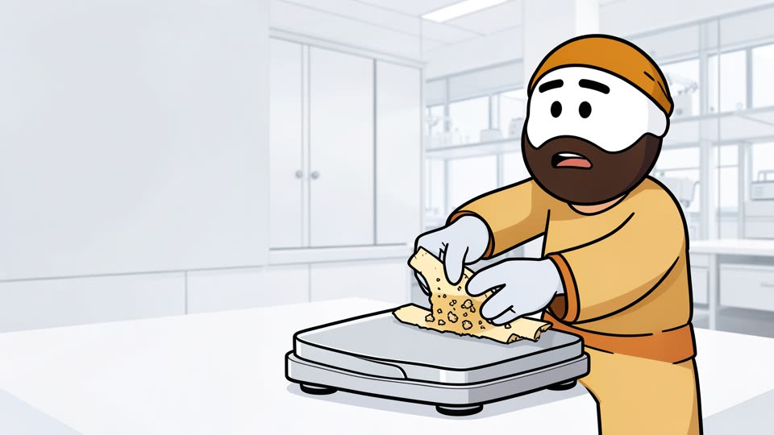

- Intento: `mystery-1-shot-8-p5` · SHA-256 `4730f509998e813b28cd0bd03abef78f017d978754c38d68807a6772442846f5`
- Fallas: adultAnatomy
- Detalle: The character's hands exhibit distorted, overlapping finger structures that result in an anatomical defect.

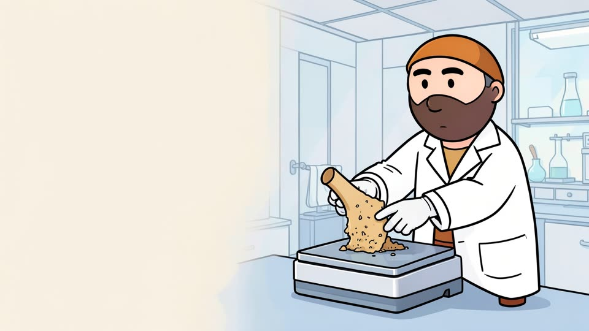

- Intento: `mystery-1-shot-8-regen1-p3` · SHA-256 `5bb1a2c703f6197aecd2d17b07e7888b1cec055e5841a4166bf381bddc1b66fe`
- Fallas: adultAnatomy, correctStyle
- Detalle: Image does not match the mandatory Eli character design from reference image 1; instead, it features a generic lab technician character. / The character's feet/legs are cropped out at the bottom frame edge, violating the instruction to have a complete view as per the reference character style. / The image includes a complex laboratory background which exceeds the 'simple background' requirement for the channel's established visual style.

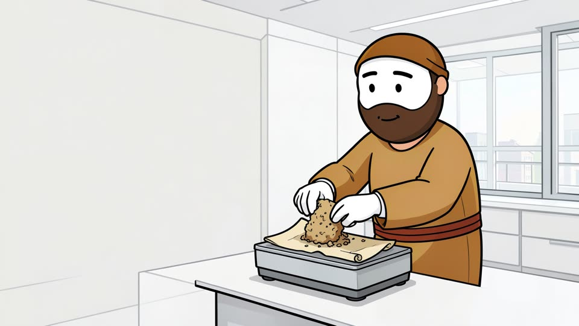

- Intento: `mystery-1-shot-8-regen1-p4` · SHA-256 `2fdfb0183311e4ba80dfd5e5bbbb16cc79b6e4d34385d6a982436553142cb7d5`
- Fallas: requiredConcept
- Detalle: The character depicted is the recurring character Eli, not a 'Technician' as requested in the concept. / The character is wearing his traditional ancient-style tunic instead of a modern lab technician attire.

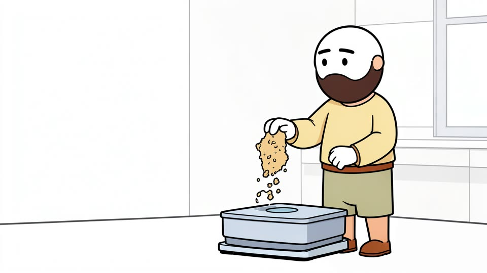

- Intento: `mystery-1-shot-8-regen1-p5` · SHA-256 `322880a861e361939ae532d6f7c93f182854094d35bd7fbb8dd0e2f4efa639c0`
- Fallas: requiredConcept, historicalAccuracy
- Detalle: The character depicted is the channel mascot Eli in his traditional ancient-style tunic, failing the concept requirement for a modern technician in a lab setting. / The depiction of an ancient-styled character performing laboratory tasks creates a mismatch with the scientific narrative beat.

## 023 · `mystery-1-shot-10`

**Narración:** more than two thousand years ago. Over the next ten years, searchers found more caves,

**Escena pedida:** A wide shot of a rugged, arid cliffside with several jagged cave openings visible. A group of men in 1950s-style desert clothing and hats stand in the distance, gesturing toward a cave entrance.

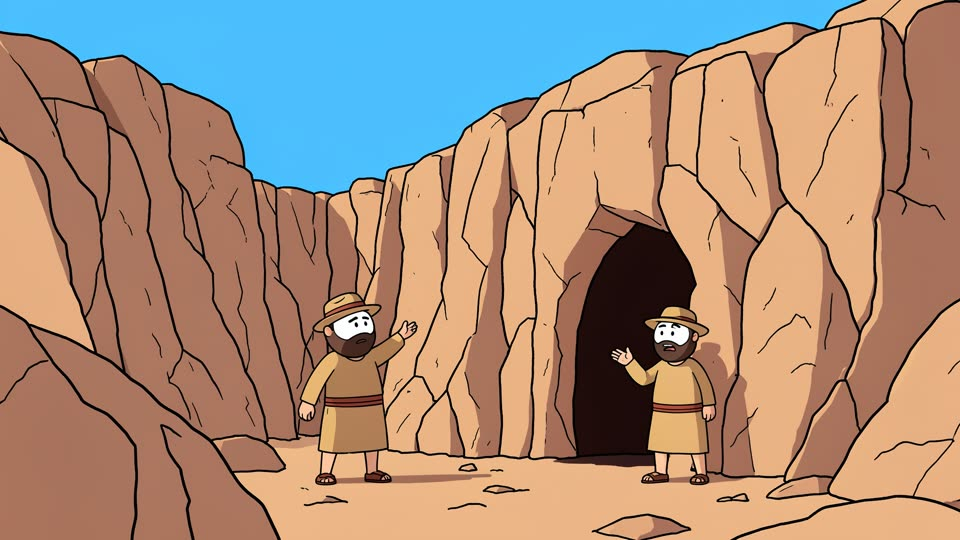

- Intento: `mystery-1-shot-10-p4` · SHA-256 `8b95533ebef438950254319dafd12f34ceff9d36db036d966c75b5af49d96bf4`
- Fallas: adultAnatomy
- Detalle: The character on the right has two left hands, which is a serious anatomical defect.

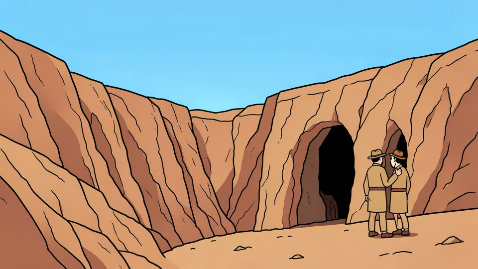

- Intento: `mystery-1-shot-10-p5` · SHA-256 `9ab74a85bc276506a99421bc6d183fda53d889cc061eeeb7d4bca3008cd53813`
- Fallas: adultAnatomy
- Detalle: The requested narrative specifies a group of men gesturing towards a cave, whereas the image only shows two men standing side by side.

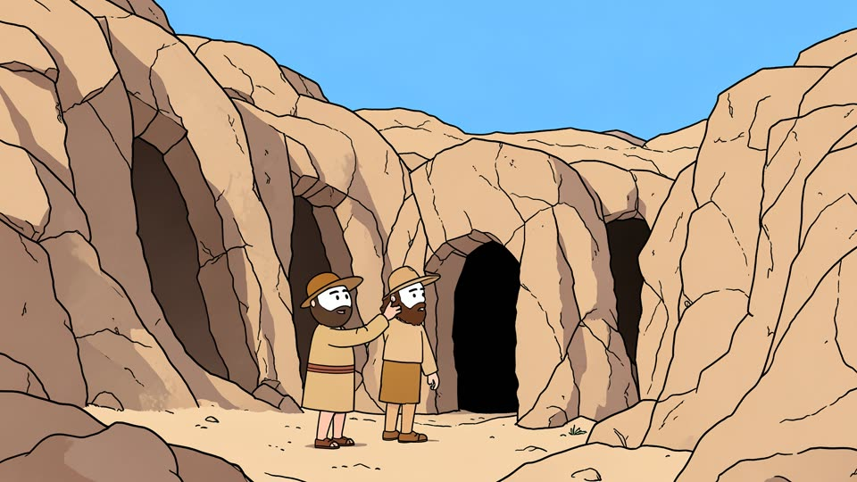

- Intento: `mystery-1-shot-10-regen1-p4` · SHA-256 `5474321a553088dfe720e1281314adfbcbf1346b585b41aaa29726ff38600635`
- Fallas: requiredConcept
- Detalle: The generated image depicts a character touching another character's head/hat, which deviates from the specified action of gesturing toward the cave entrance. / The composition shows two characters, but the interaction is not aligned with the instructional 'searcher' narrative.

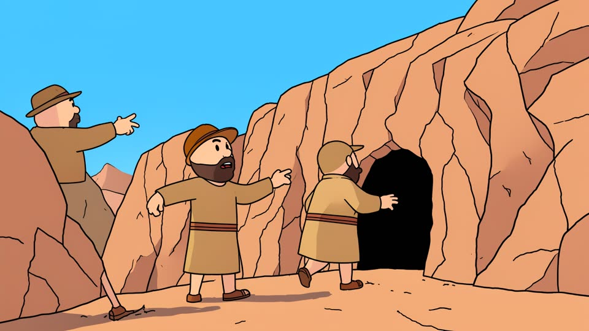

- Intento: `mystery-1-shot-10-regen1-p5` · SHA-256 `0b7d51ca2e2230d2334ec95aa2dd92d2590968180725b1ee65e1941ebd954e62`
- Fallas: adultAnatomy, requiredConcept
- Detalle: The concept explicitly required exactly two characters, but three are present. / One of the characters has a distorted, malformed leg extending from behind the rock structure that does not connect correctly to the body.

## 025 · `mystery-1-shot-12`

**Narración:** tens of thousands of pieces, some smaller than a fingernail. Putting them back together

**Escena pedida:** A close-up view of a pair of metal tweezers carefully handling a fragile, crinkled scrap of ancient leather over a white light table. Surrounded by thousands of other tiny, dark parchment fragments scattered across the surface.

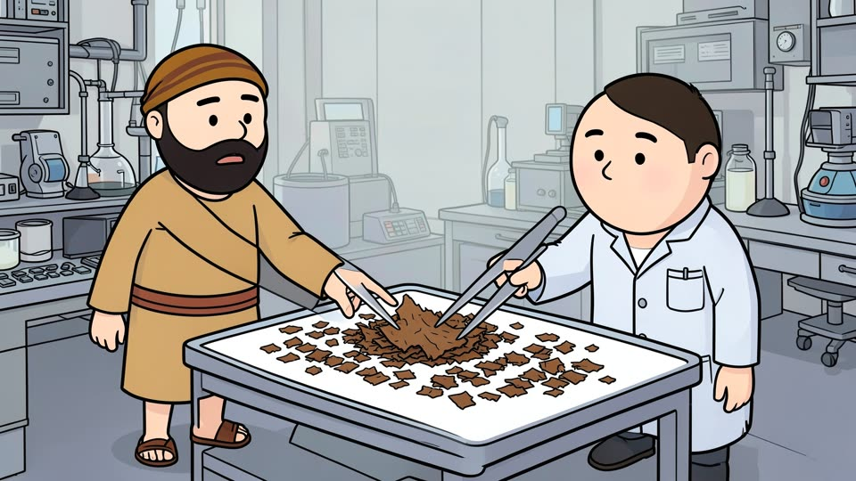

- Intento: `mystery-1-shot-12-p3` · SHA-256 `0635c04f8c40ee7cc3c2fccd21c0e0e99e0613baa2542076ccb7bf28aa46d2fa`
- Fallas: correctStyle
- Detalle: Image contains excessive background detail, violating the LOW TO MEDIUM density requirement. / The style is overly complex compared to the simple expressive reference character style. / The inclusion of a second, non-Eli character is not requested in the concept.

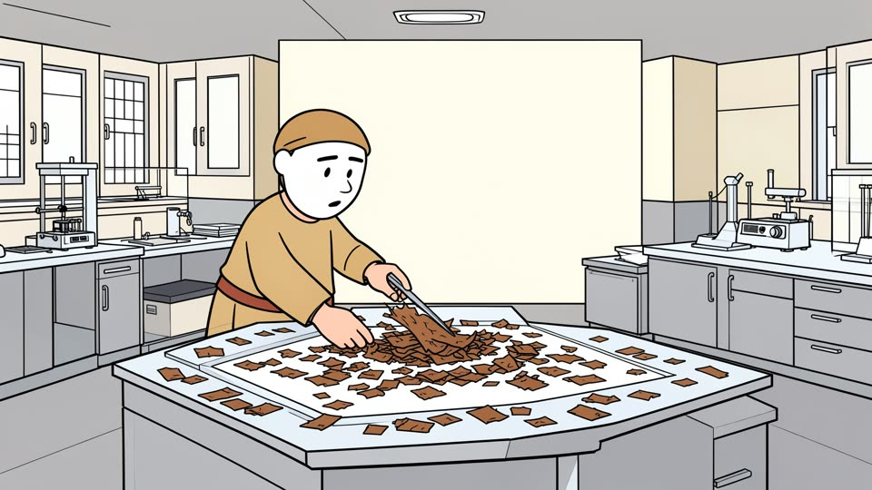

- Intento: `mystery-1-shot-12-p4` · SHA-256 `3aec15ecbc18156377c4e20747e4a3dd76b4a2755afd59a7fedad80218d1a302`
- Fallas: correctStyle
- Detalle: Character design deviates from Eli: missing beard, face features are too detailed/anatomical compared to reference dot-eye/circle-head style. / Density is too high: the laboratory environment is overly complex and busy, contradicting the simple reference style requirements. / Reference style requires expressive round-head cartoon with simple, flat-colored backgrounds; this image uses a highly detailed, realistic perspective-based laboratory interior.

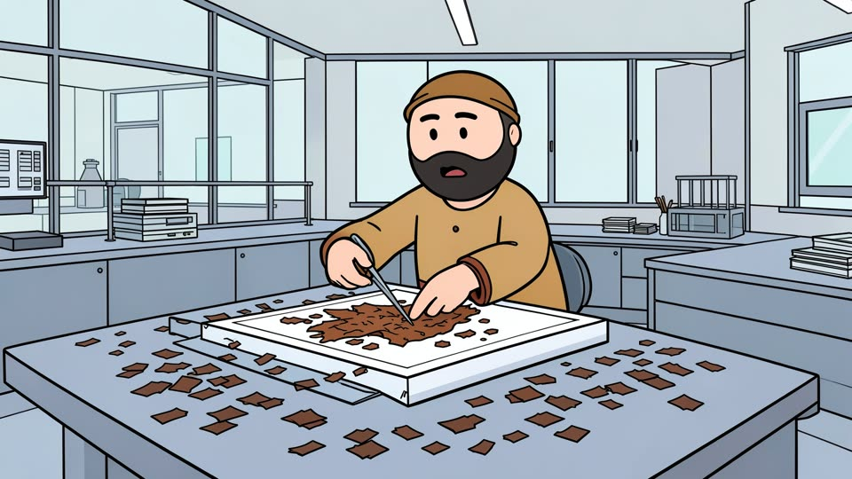

- Intento: `mystery-1-shot-12-p5` · SHA-256 `74be14509d68d7be0e247bb5aaac02360c5cd5e7418f17fa9395a3f2c85bd15f`
- Fallas: correctStyle
- Detalle: Character design deviates significantly from reference: Eli appears in modern lab attire rather than the signature sand-colored tunic and head cloth. / Density is too high; the complex lab background, equipment, and numerous scattered fragments significantly exceed the reference style of simple, uncluttered space. / Color palette is overly cool/grey (lab aesthetic) compared to the warm color requirement.

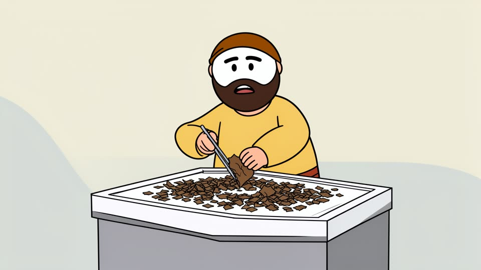

- Intento: `mystery-1-shot-12-regen1-p3` · SHA-256 `8b0b8ab7861453d525afc04afa6116cf1804fad384e350d38c972ad0cc30f055`
- Fallas: requiredConcept, historicalAccuracy
- Detalle: Character is the recurring character Eli in ancient attire, not a 20th-century researcher. / The environment lacks the 'modern research laboratory' context required by the concept. / Historical mismatch: Character is dressed in ancient-style tunic and head covering instead of modern researcher clothing.

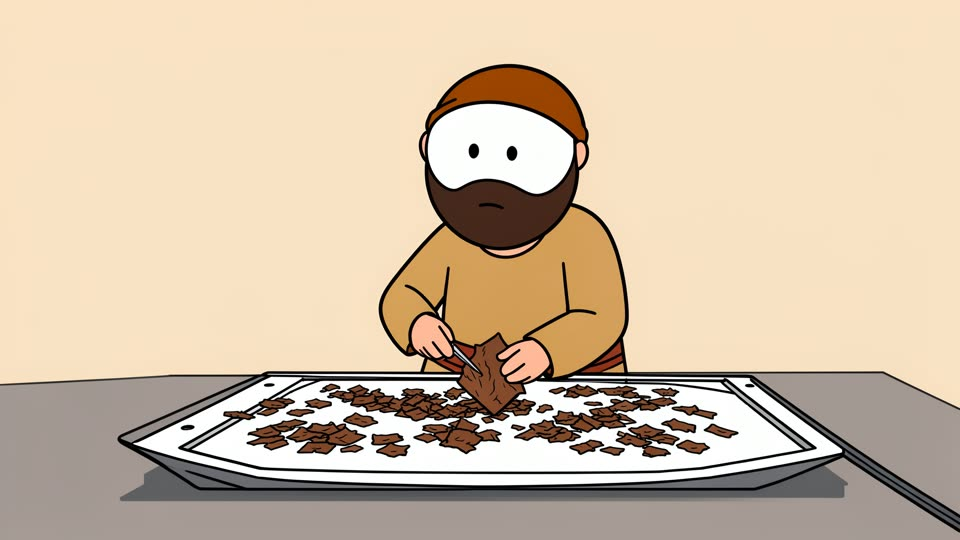

- Intento: `mystery-1-shot-12-regen1-p4` · SHA-256 `7abe28285e1aece6c8e0a37f0673942f2ceafc8ba5b2b7dd651a63e3165cb468`
- Fallas: requiredConcept, historicalAccuracy
- Detalle: Character is Eli from the ancient world, not a modern researcher / Concept required a 20th-century researcher in a lab, but the image features the recurring channel character Eli in his traditional ancient-style tunic

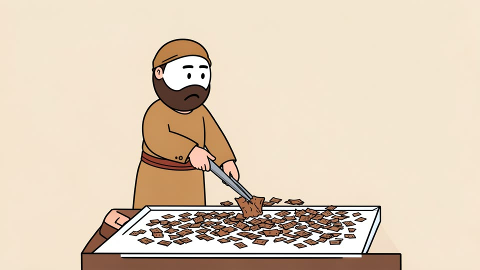

- Intento: `mystery-1-shot-12-regen1-p5` · SHA-256 `ff23b1ea4afa78a2570d95f5586d0fe1b0407cdda3f39f4be6445fbf0816dff9`
- Fallas: requiredConcept, historicalAccuracy
- Detalle: Character is Eli, not a modern researcher / Concept misaligned with historical context of the prompt / Failed to represent a modern scientific environment/laboratory

## 026 · `mystery-1-shot-13`

**Narración:** took decades, like a jigsaw puzzle with most of the pieces missing.

**Escena pedida:** A researcher sitting at a desk with an oversized magnifying glass, hunched over a large frame where parchment pieces are being painstakingly aligned. The frame is mostly empty space, emphasizing the missing segments.

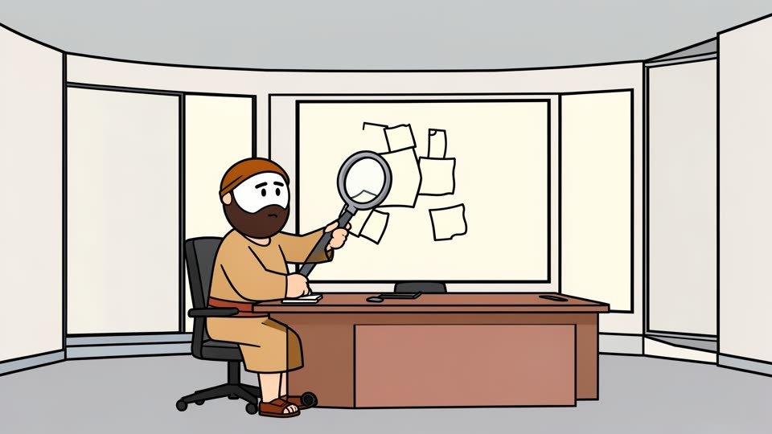

- Intento: `mystery-1-shot-13-p3` · SHA-256 `fb9ea9d9f9a5eb4165a1ff857352afdec875ca78fc847040058f5a5d4962feae`
- Fallas: requiredConcept, historicalAccuracy
- Detalle: The character Eli (ancient attire/sandals) has been inexplicably placed in a modern corporate office setting, violating the historical context of the concept. / The character concept asks for a researcher, but the image shows Eli, the channel's specific biblical-era character, which creates a thematic mismatch.

- Intento: `mystery-1-shot-13-p4` · SHA-256 `2662d5ac7335332972ba00beea11403030a12062d4de576d4ed7f21a0bedee98`
- Fallas: requiredConcept
- Detalle: The character Eli is used as a stand-in for a modern-day researcher instead of an original character, which contradicts the concept requirement. / The narration and concept describe the researcher hunched over a desk examining parchment pieces with a magnifying glass; the provided image does not show parchment pieces being aligned or a jigsaw puzzle effect, but rather a magnifying glass held up in thin air. / The frame is largely empty and fails to depict the core narrative action of 'painstakingly aligning parchment pieces'.

- Intento: `mystery-1-shot-13-p5` · SHA-256 `7b16f8ea222336a0a6fb08823d8609fce11ce61a6631f500c7d73970ee3f506f`
- Fallas: adultAnatomy, correctStyle
- Detalle: Character design does not match the mandatory Eli reference style (missing bearded round-head features, incorrect head cloth/hair color). / The magnifying glass is positioned in an anatomically impossible way that obscures and distorts the head/face structure. / The image lacks the specific 'Eli' character design mandated by the reference instructions.

- Intento: `mystery-1-shot-13-regen1-p3` · SHA-256 `cacf5b36e3d139429da3623b17cc3423137095f51ad30599bd265420568b0678`
- Fallas: requiredConcept
- Detalle: The character depicted is the recurring character Eli, not a 'researcher' as specified in the concept. / The character is wearing his iconic ancient-style tunic instead of modern office attire suitable for a 20th-century museum academic setting.

- Intento: `mystery-1-shot-13-regen1-p4` · SHA-256 `6e359db326b3c2cb5934c8b6328d702c607b9834ddb67c83be239b94a29ea86a`
- Fallas: adultAnatomy, requiredConcept
- Detalle: The character depicted is the recurring channel character Eli from the reference image, which contradicts the concept requirement for a generic researcher. / The character's head is partially obscured by the magnifying glass in a way that makes it unclear and obscures the required expressive face. / The concept requested a researcher, but the character design is locked to the channel's Eli character, failing the specific concept identity.

- Intento: `mystery-1-shot-13-regen1-p5` · SHA-256 `64f3c283f6823811a24780fff7e44b24ff7efdf4a9d897d357c351be53d67304`
- Fallas: requiredConcept, historicalAccuracy
- Detalle: The character used is the channel's recurring character Eli (ancient attire) instead of the requested 'researcher' for a 20th-century museum context. / The historical context (modern office/museum) is contradicted by the character's attire (ancient tunic/head cloth).

## 027 · `mystery-2-shot-0`

**Narración:** Mystery number two: how did they survive? Leather and parchment usually rot away.

**Escena pedida:** A wide shot showing the desolate, sun-bleached cliffs of the Judean desert. Dry, cracked earth in the foreground. No vegetation, just jagged limestone rocks under a harsh, unforgiving sun.

- Intento: `mystery-2-shot-0-p3` · SHA-256 `78d5bd2e0a3544ac97ac0ae226ee408dae4ecdc086e9937987fcbaa45b50e7d2`
- Fallas: adultAnatomy
- Detalle: Image contains two Eli-like characters instead of the singular primary subject required by the reference style for this beat. / The character scale is inconsistent/confusing within the single scene.

- Intento: `mystery-2-shot-0-p4` · SHA-256 `8c003c223c23fc0e368eb0bd94b5d190865a2bffd755487e1b848b446e8944c4`
- Fallas: correctStyle
- Detalle: The image includes a second, smaller, and differently designed character who does not match the 'Eli' reference or the requested style grammar. / The inclusion of an unrequested secondary character deviates from the 'one primary subject' density target. / The style of the second character features different eye and facial design compared to the established channel character Eli.

- Intento: `mystery-2-shot-0-regen1-p3` · SHA-256 `1c1775393a752f9c23039a315fe8efb7c2196845469f687b344a6a1affdaa154`
- Fallas: requiredConcept
- Detalle: The concept explicitly requested an empty scene with no people, but a character was included.

- Intento: `mystery-2-shot-0-regen1-p4` · SHA-256 `fa726c81c3b31dd04b071405ad3e8eedf4158fad0d6216974d8ec01d30a29403`
- Fallas: requiredConcept
- Detalle: Concept failure: Prompt requested an empty scene with no people, but the generated image includes the character Eli.

## 029 · `mystery-2-shot-2`

**Narración:** with reed pens. Then they spent two thousand years in some of the driest air on

**Escena pedida:** Close-up of Eli's hands using a hand-carved reed pen to draw black ink letters onto leather. A small, flickering oil lamp sits nearby, casting a warm, soft glow on the work surface.

- Intento: `mystery-2-shot-2-p3` · SHA-256 `85e84656f45c95e489d380483e291cce184d02e1df8196a8eb504678f6f54b56`
- Fallas: requiredConcept, historicalAccuracy, correctProp, noBakedText
- Detalle: The image includes baked text in the form of letters on the scroll, which violates the requirement for no text. / The concept requested a hand-carved reed pen, but the image depicts a bird feather quill, which is an anachronism for the 1st century BCE Judean context provided in the concept description. / The scene includes a complex collection of miscellaneous tools and pottery, violating the low-to-medium density constraint.

- Intento: `mystery-2-shot-2-p4` · SHA-256 `58639318afcd36a02b1eaf523e5977006011c342db6b255f9901fc94ddb483ce`
- Fallas: historicalAccuracy, correctProp, noBakedText
- Detalle: Image contains baked text which is prohibited. / Major historical error: Image includes modern-style metal pipe fixtures/valves in the bottom left and right corners, which are incongruous with 1st-century Judean material culture. / Density too high: The scene is cluttered with various tools and objects not specified in the concept, violating the 'Low to Medium' density target.

- Intento: `mystery-2-shot-2-regen1-p3` · SHA-256 `24c0ab9f39420a821fc2a1800556ff381d7d5a1c97f3c09f36e405c6216a82f7`
- Fallas: correctStyle
- Detalle: Style mismatch: The generated image uses detailed shading, complex textures, and realistic lighting, which conflicts with the required simple, flat-colored cartoon style of the reference image. / Density mismatch: The image is cluttered with numerous tools, props, and detailed background elements, far exceeding the simple, low-density requirement. / Character design inconsistency: Eli's face and features do not match the simple white-circle, dot-eye, bold-brow aesthetic established in the reference character.

- Intento: `mystery-2-shot-2-regen1-p4` · SHA-256 `3213d1ab8f7a7a6f5eaf960c30e6a7c04897d6de44b8aa8f8c243597972ad910`
- Fallas: adultAnatomy, correctStyle
- Detalle: Character design deviates significantly from reference image 1 (hair/head cloth style, facial proportions/features). / Anatomy error: Eli appears to be holding two distinct writing instruments/quills simultaneously in an awkward, non-functional way, creating an anatomical/structural visual error regarding hand usage. / The table perspective is distorted.

## 032 · `mystery-2-shot-5`

**Narración:** them even more. Others simply lay on the cave floor, where insects, rodents

**Escena pedida:** A close-up of a weathered, dark leather scroll fragment resting directly on the rough, uneven stone floor of a desert cave. The texture of the dried leather is cracking and fragile, resting in the shadows.

- Intento: `mystery-2-shot-5-p3` · SHA-256 `2a7f1c691b8b3f6a39b069c9b3e53138426107de35688ac989dc96958a93b2d9`
- Fallas: historicalAccuracy, correctProp
- Detalle: Major historical error: Image includes industrial metal tools/shovels that are inconsistent with the 1st century BCE Judean desert context.

- Intento: `mystery-2-shot-5-p5` · SHA-256 `05573d8ea37deec62bbb5c70d355ce0c11d41dbeb7f401565482ce5206d5b59b`
- Fallas: correctStyle
- Detalle: The visual style of Image 2 significantly deviates from the reference style. While the reference utilizes a 'simple expressive round-head cartoon' style with flat colors and very bold outlines, Image 2 uses more painterly, textured shading and gradients, lacking the required clean flat color aesthetic.

- Intento: `mystery-2-shot-5-regen1-p3` · SHA-256 `930a518cbbd8abc16cb21650768fdfd6f73127e8188d6866dc9778fd1cd86d26`
- Fallas: requiredConcept
- Detalle: The requested concept was for a leather scroll fragment in a cave; however, the image provided is of the channel's lead character, Eli, which is a direct contradiction of the prompt requirement for an empty scene without characters.

## 034 · `mystery-2-shot-7`

**Narración:** while another holds only crumbs of writing.

**Escena pedida:** A low-angle shot showing the floor of a different, neglected cave. Small, brittle, indecipherable scraps of parchment are scattered amongst gravel and cave dust, suggesting the loss of historical information to time and decay.

- Intento: `mystery-2-shot-7-p3` · SHA-256 `c30b9a0784c7a4553d493175cd1f96df0663c6f114ef91e0fa06e66449461566`
- Fallas: readableOutput, noBakedText
- Detalle: Baked text on parchment fragments containing nonsensical characters. / Concept asks for one subject with functional supports; the image contains two primary subjects, changing the composition significantly from the requested beat.

- Intento: `mystery-2-shot-7-p4` · SHA-256 `00a015130258087d386b51805d9be6773986f60ba73c0718eebb9acaf9b0ec73`
- Fallas: requiredConcept
- Detalle: Image contains two characters instead of one primary subject as per reference density guidelines / Background includes numerous props (tools, wood) that increase visual complexity beyond the requested LOW TO MEDIUM density

- Intento: `mystery-2-shot-7-regen1-p3` · SHA-256 `6e490e3ae428a43cd063dfa7779e6319d57b9f6c885cc8c10dc8aef9ba7403ed`
- Fallas: requiredConcept
- Detalle: The concept required an empty scene showing a neglected cave with scattered parchment scraps; however, the provided image includes Eli, violating the instruction to have no people at all.

- Intento: `mystery-2-shot-7-regen1-p4` · SHA-256 `272020e92188399c30f1bcc2a840a31012e3036238f00fb9c4de4cb3f43d8ca3`
- Fallas: correctStyle
- Detalle: The style of the cave floor and rocks deviates from the simplified, flat-colored cartoon aesthetic of the reference; it uses more complex shading and line work inconsistent with the Eli character style.

## 036 · `mystery-3-shot-1`

**Narración:** manuscripts. Most are written in Hebrew, with some in Aramaic and

**Escena pedida:** Eli sits at a wooden table in a stone room, working with a reed pen. He is focused on writing crisp, dense Hebrew characters onto a fresh leather scroll. An inkwell sits beside him, and the room is lit by natural morning light.

- Intento: `mystery-3-shot-1-p3` · SHA-256 `577def5613a657493b45fa49be2bfd3ba8fa74901ea65c721833c3a25067eff2`
- Fallas: historicalAccuracy
- Detalle: The metal tool on the wall (top right) contains complex, anachronistic ironwork that is historically inaccurate for 1st-century BCE Judean writing tools. / The density is higher than the target reference due to the inclusion of extra tools/objects in the background that were not required.

- Intento: `mystery-3-shot-1-p4` · SHA-256 `ba8d969ee4a60dcbed894d5e1d56555795daec0d95ac12e1b714e1bfc31c943a`
- Fallas: adultAnatomy
- Detalle: Anatomy defect: The character's right hand holding the pen is merged incorrectly with the scroll/pen area in a way that creates an impossible hand structure.

- Intento: `mystery-3-shot-1-regen1-p3` · SHA-256 `eff001e9667fbed0732563e74c45217169c4b4d5a438766ad8f783088683f81f`
- Fallas: historicalAccuracy, correctProp
- Detalle: The scribe is using a modern mechanical pencil (with a visible metal ferrule and eraser) instead of the required reed pen.

- Intento: `mystery-3-shot-1-regen1-p4` · SHA-256 `0eeb50ffe5192725a9ed2a473084ca2e2dc32ebb8a06d7a6c8e88ed48ec4f957`
- Fallas: historicalAccuracy, correctProp
- Detalle: The wooden table/desk has a modern construction (slatted design, joinery) that is anachronistic for the 1st century BCE. / The reed pen is drawn with a metallic-style nib or overly complex hardware appearance inconsistent with the required simple illustrative style.

## 037 · `mystery-3-shot-2`

**Narración:** a few in Greek. Many of them are copies of books from the Hebrew Bible, and fragments

**Escena pedida:** Eli sits on a stone stool in a dimly lit, dry stone room. He is carefully drafting a text on a scroll using a reed pen dipped in dark ink. Sunlight streams through a narrow opening in the high wall, highlighting dust motes.

- Intento: `mystery-3-shot-2-p3` · SHA-256 `bf8d84487b9d1b779bed26dfaed91421caef41306079397809fbe1e8be51aecd`
- Fallas: adultAnatomy
- Detalle: Anatomical failure: The character's left arm is merged into his body, and the wrist/hand connection is structurally broken. / The placement of the reed pen and its interaction with the scroll suggests a hand deformity where the pen is floating or merged.

- Intento: `mystery-3-shot-2-p4` · SHA-256 `d7d28e8411d9c1948e358afd8e6abe5bfe8ee65ec6989bf5f963ac69a287f398`
- Fallas: correctProp
- Detalle: The instrument used to write is visually a modern pencil rather than a reed pen.

- Intento: `mystery-3-shot-2-regen1-p3` · SHA-256 `27da5c1d06ba5cc81fe797809e078b669c958db11469f01477ae2b2df9c287ec`
- Fallas: historicalAccuracy, correctProp
- Detalle: majorHistoricalError: Presence of modern industrial metal tools and pipe-like implements in a 1st-century BCE setting. / The environment contains too much clutter/props inconsistent with the simple density requirement.

- Intento: `mystery-3-shot-2-regen1-p4` · SHA-256 `8d122c954990fae7950f40bbdca0a8054f68fa13c12441c903230b0cefd69955`
- Fallas: adultAnatomy
- Detalle: Anatomy error: the character's right hand holding the quill merges into the wrist/scroll in a distorted way, and the left hand has unclear finger structure. / The character's head-to-body proportion differs significantly from the reference Eli (which has a flatter, simpler 'round-head' look), appearing slightly more realistic/modeled.

## 039 · `mystery-3-shot-4`

**Narración:** commentaries, calendars and rules for a religious community. The most famous is

**Escena pedida:** Eli sits at a communal table with two other simple robed individuals. They are discussing a spread-out scroll. A small oil lamp sits on the table casting long shadows against the rough masonry walls.

- Intento: `mystery-3-shot-4-p3` · SHA-256 `b1e8e3988ed9a8be141f5c122bfa36f78b1618f19943a6709b728641b6ceb5c8`
- Fallas: adultAnatomy
- Detalle: The image depicts three characters rather than the requested one primary subject with 0-3 functional supports as implied by the density target, and the complexity of the scroll illustration exceeds the simple cartoon style established in the reference.

- Intento: `mystery-3-shot-4-p4` · SHA-256 `18754c424a95079db7562477cae32a7b02c9acaf124a4dd56290d2247d494bbc`
- Fallas: requiredConcept
- Detalle: The concept requested three individuals (Eli and two community members), but only two individuals are depicted. / Eli (the recurring character) is identified by his specific beard and head cloth; however, the two characters in the image appear to be variations of the same model and it is not clear which one, if either, is intended to be Eli.

## 043 · `mystery-3-shot-8`

**Narración:** They found that the ancient scroll largely agrees with the later copies, although it has many small

**Escena pedida:** Eli the scribe sits at a low wooden table, hunched over an open, long leather scroll. His face is lit by the warm glow of a small clay oil lamp. Beside him, a medieval-era manuscript is laid open for comparison. He looks closely at the text, his hand hovering over the parchment.

_Sin imagen: el pedido fue rechazado antes de dibujar o Cloudflare la bloqueó._

## 044 · `mystery-3-shot-9`

**Narración:** differences in spelling and wording. For historians, that is a rare window into how

**Escena pedida:** A close-up of Eli's hand holding a sharpened reed pen, hovering over a line of Hebrew characters on a leather scroll. A small bowl of black ink sits nearby. The focus is on the textures of the dried animal skin and the faded ink lines.

- Intento: `mystery-3-shot-9-p3` · SHA-256 `febf24dfe2cdbba811c1bd4938d59d171ff971551207f9534696c14d8ec7d80a`
- Fallas: adultAnatomy
- Detalle: Anatomical failure regarding the hands holding the pen

- Intento: `mystery-3-shot-9-p4` · SHA-256 `295857e874bd7eeb1f9819a017a68cbcd05a47bacb78c44cae0f04b9d00f07d0`
- Fallas: correctStyle, requiredConcept
- Detalle: Image contains two identical characters instead of a close-up on a single character's hand. / Style departs from the minimalist reference; uses complex shading and textures inconsistent with the flat-color requirement. / Fails the single-character constraint; includes an unnecessary second character.

- Intento: `mystery-3-shot-9-regen1-p3` · SHA-256 `2bb24cb42294b6f9ef6ae1b42196e60d20383fc565510435c26b22ffb802233e`
- Fallas: correctStyle
- Detalle: Style mismatch: The requested style is simple flat-colored cartooning. The image uses complex digital shading, textures, and gradients which deviate from the reference. / Density mismatch: The image is highly detailed and textured, contradicting the 'Simple expressive' and 'low to medium density' requirement. / Character design: The character's face and style are more complex and rendered than the reference Eli.

- Intento: `mystery-3-shot-9-regen1-p4` · SHA-256 `2a723f644e6c08098680c9117edacb074cfc0d1904f39a00121aabd665edfbea`
- Fallas: adultAnatomy, requiredConcept
- Detalle: The character design of Eli in image 2 does not match the reference character Eli from image 1. The provided Eli has a rounded face/chin shape and different expression/eye positioning that departs from the established model sheet. / The anatomical structure of the hand gripping the pen is malformed and logically impossible; the thumb and fingers are merged in a way that does not correspond to the requested simple mitten or drawn-finger style.

## 045 · `mystery-3-shot-10`

**Narración:** ancient scribes copied, and sometimes changed, the texts they treasured.

**Escena pedida:** Eli looks contemplative, glancing back and forth between two different scrolls spread out on his workspace. He holds a reed pen, his expression suggesting the weight of his duty as he carefully records a character from one sheet to the next.

- Intento: `mystery-3-shot-10-p3` · SHA-256 `e7189b9052c6970824f79246492c63eeff55f9a5d8dba0bf9fdfbc0f5975208f`
- Fallas: adultAnatomy
- Detalle: The hand holding the pen is anatomically incorrect, appearing to have fingers emerging directly from the wrist/palm area without a proper thumb or hand structure. / The pen orientation is physically impossible as it seems to float or be held by the side of the hand rather than gripped by fingers.

- Intento: `mystery-3-shot-10-p4` · SHA-256 `047ab99490f3c8494c0c860673f4d8fb743d8bd84531544d38f3341fb3e6bafc`
- Fallas: adultAnatomy
- Detalle: The character holds two pens simultaneously while working, which deviates from the specified action of holding a single reed pen and creates an odd hand/object configuration.

- Intento: `mystery-3-shot-10-regen1-p3` · SHA-256 `a52596e1832c0455ca1bd83dc32df2dba46ea33534b91a354524b3d3f5cc6087`
- Fallas: adultAnatomy
- Detalle: Eli character mismatch: The character in the image has a different head cloth pattern and expression compared to the reference character. / Missing action: The prompt specified Eli looking back and forth between two scrolls; the image shows him looking down at one, which misses the intended narrative nuance.

- Intento: `mystery-3-shot-10-regen1-p4` · SHA-256 `6bb048b311b16922edbf7bd495a8c2dfda2e9ad1b075976e2e346e646aadabd0`
- Fallas: adultAnatomy
- Detalle: The character in the image is standing, but the prompt specified that Eli is looking back and forth between two scrolls at a workspace, implying a more seated or focused interaction; the current pose feels disconnected from the specific task of transcribing. / The character design deviates slightly from the reference Eli (different headgear style, lack of striped pattern on headcloth).

## 047 · `mystery-4-shot-1`

**Narración:** Archaeologists dug there in the years that followed. They found a long room that some called a writing

**Escena pedida:** A modern-day archaeologist in 1950s attire is kneeling on the floor of a stone room, brushing dust away from the foundation. They are uncovering a space that looks like a communal workspace, with stone debris around them.

- Intento: `mystery-4-shot-1-p3` · SHA-256 `767ee557799f77d1851cad29ecc310e232148c0789325965bece27deb0a7aac7`
- Fallas: historicalAccuracy, correctProp
- Detalle: The subject is wearing a modern hard hat, which is inconsistent with the requested 1950s attire and archaeological dig site context. / The subject is kneeling, and the way the legs are rendered under the tunic creates a slightly ambiguous anatomical joint connection, though this is borderline for the simplified style.

- Intento: `mystery-4-shot-1-p4` · SHA-256 `057b6c9490bf7c734c56dc5e247915e3bc2db615a414aef18bbe401a18b71cf9`
- Fallas: correctStyle
- Detalle: Character design deviates significantly from reference style (wrong face shape, eyes, and eyebrows) / Eli character was not used as the subject

- Intento: `mystery-4-shot-1-p5` · SHA-256 `b6f4591a1cb6df0f635e682968fdb5d628b1bbdbe2969e7600ab746060495946`
- Fallas: historicalAccuracy
- Detalle: The character is wearing a generic 'biblical' tunic and head cloth instead of 1950s archaeological work clothing (plain cotton work clothes/trousers as requested in the concept). / The character uses a small hand brush, but lacks the trowel mentioned in the historical context.

- Intento: `mystery-4-shot-1-regen1-p3` · SHA-256 `a76db66bc08ad77c2e7d9dbc46a7536da73cdbf5ad1a4b3975655a0e3ec0422b`
- Fallas: requiredConcept, historicalAccuracy
- Detalle: The character depicted is the recurring channel character Eli (the historical figure from reference 1) instead of a modern-day archaeologist. / The clothing matches the historical character's tunic rather than 1950s work attire.

- Intento: `mystery-4-shot-1-regen1-p4` · SHA-256 `bb01bb184c4023983ae97a6d8f011625d0749a90f48393f01bb32e1bd9009927`
- Fallas: historicalAccuracy
- Detalle: The character provided does not match the 1950s archaeologist concept described; he is dressed in the recurring character Eli's ancient period tunic and sandals instead of 1950s work clothes. / Major historical error: The subject is wearing ancient tunic/sandals instead of the required 1950s attire.

- Intento: `mystery-4-shot-1-regen1-p5` · SHA-256 `10447de7c83a1a5bec8169df53c0b703e04f20461919a2d75ab9c341db8b5d5a`
- Fallas: historicalAccuracy
- Detalle: The character is wearing a tunic, sash, and sandals, which is inconsistent with the required 1950s archaeological attire (plain cotton work clothes).

## 055 · `mystery-4-shot-9`

**Narración:** debated, and the evidence does not settle it. Some archaeologists even suggest

**Escena pedida:** A modern archaeologist in plain field clothing stands amidst the dusty stone foundations of an ancient Judean settlement, holding a notebook and gesturing toward the uneven terrain while deep in thought. The atmosphere is neutral and scholarly, with the desert sun casting long shadows over the scattered limestone remains.

_Sin imagen: el pedido fue rechazado antes de dibujar o Cloudflare la bloqueó._

## 057 · `mystery-4-shot-11`

**Narración:** that its link to the scrolls is weaker than it looks. One scroll makes the mystery even

**Escena pedida:** A close-up of a dark, narrow cave corner. Eli, wearing a worn wool cloak, crouches down, his hand hovering over a collection of fragmented scrolls and broken pottery shards lying on the sand. He looks at the remnants with a mixture of curiosity and caution, reflecting the obscurity of the site's history.

- Intento: `mystery-4-shot-11-p3` · SHA-256 `22fd2515ad28fc2976c8675b781bba841d57fdc2efd587f49ddd61c6eeef92b8`
- Fallas: adultAnatomy
- Detalle: The anatomical structure of Eli's legs and torso while crouching is distorted, creating an impossible joint/limb configuration.

- Intento: `mystery-4-shot-11-regen1-p3` · SHA-256 `766576549c4bbbf3662f319517a8f4bd81b30bfd4889751f13f7def12c3f437b`
- Fallas: adultAnatomy
- Detalle: The character is shown with two right feet/sandals in the crouched position, which is an anatomical error.

## 058 · `mystery-4-shot-12`

**Narración:** stranger. It is not written on leather, but on thin sheets of copper. It is

**Escena pedida:** A close-up shot of a pair of calloused, ancient hands pressing a reed stylus into a thin, oxidized sheet of copper. The metal catches the flickering light of an oil lamp, highlighting the deep, deliberate indentations forming rows of precise, ancient Hebrew characters.

_Sin imagen: el pedido fue rechazado antes de dibujar o Cloudflare la bloqueó._

## 060 · `mystery-4-shot-14`

**Narración:** one has ever found that treasure, and scholars still argue about whether it was ever real.

**Escena pedida:** Two modern researchers in a well-lit office study a high-resolution, sepia-toned photograph of a flattened copper scroll. They lean over a mahogany desk cluttered with reference books, pointing at a passage in the document, their expressions intense as they debate the validity of the hoard described.

- Intento: `mystery-4-shot-14-p3` · SHA-256 `0f4d9020ed249c8ee6d668a9127bf10d3bc0833ae382470a9dbc13001f616de1`
- Fallas: historicalAccuracy
- Detalle: The concept requires modern-day researchers in a 21st-century academic setting, but the characters are wearing ancient-style tunics and head cloths, creating a major historical/contextual error for the requested scene. / The provided characters do not represent modern researchers.

- Intento: `mystery-4-shot-14-p4` · SHA-256 `e9852323b5baf2342025b3af17faa3c4bc95bcd3af100612a4e62c430a8889da`
- Fallas: historicalAccuracy
- Detalle: The image depicts characters wearing ancient-style tunics despite the explicit historical context requirement of a 21st-century academic setting. / The prompt required specific character roles for two modern researchers, but the visual execution includes a character (left) wearing a tunic identical to the recurring ancient channel character Eli, which conflicts with the requested modern academic setting.

- Intento: `mystery-4-shot-14-p5` · SHA-256 `0964f43033a1db96c924028a74b7ab0485720bc73a26b3fb5b194d8952342b74`
- Fallas: historicalAccuracy
- Detalle: The character design fails to maintain the established 'Eli' character design requirements, specifically the attire. / The historical context provided was for a modern-day academic setting, yet the characters are depicted in ancient-style tunics, creating a clash between the requested concept and the visual output.

- Intento: `mystery-4-shot-14-regen1-p3` · SHA-256 `c0ca6e66457aa66a09e5962b454e0f3d635b0a5ece2e25af0af16b2161c23182`
- Fallas: requiredConcept
- Detalle: The concept requires exactly 2 researchers; the image includes an unrequested third character (Eli) in the scene. / The character count mismatch alters the intended scene composition.

- Intento: `mystery-4-shot-14-regen1-p4` · SHA-256 `c7f311f34cc01bb6c2d25274684d8fe9ccaf1742bfe58337302425961c6bb9de`
- Fallas: requiredConcept, noBakedText
- Detalle: The image contains three characters instead of the requested two. / The document contains baked-in nonsensical text/symbols. / The density is higher than the reference style due to extra character and desk clutter.

- Intento: `mystery-4-shot-14-regen1-p5` · SHA-256 `2cb7e3d9e3638ce8c850aedd319bb9c383d25b9e3129d3fe05b32c599c06a5f1`
- Fallas: requiredConcept
- Detalle: The concept requested two researchers, but one of the characters is clearly the recurring ancient channel character Eli (in his signature tunic/head cloth), contradicting the modern academic setting. / The image depicts Eli in an anachronistic modern setting, failing the core concept consistency.

## 061 · `mystery-5-shot-0`

**Narración:** Mystery number five: how did four of them end up for sale in a newspaper? In

**Escena pedida:** A close-up of a person's hands searching through a stack of late-night newspaper editions on a cluttered desk in the 1950s, looking for a classified advertisement.

- Intento: `mystery-5-shot-0-p3` · SHA-256 `235214285b5dc2ba1f3baad0c91791275ae08030fe34505ccb7171e392c3ff0e`
- Fallas: adultAnatomy, historicalAccuracy
- Detalle: The character Eli (Biblical/Ancient appearance) is placed in a 1950s professional office setting, creating a severe historical anachronism. / The hands in the image have inconsistent/malformed finger structure.

- Intento: `mystery-5-shot-0-p4` · SHA-256 `e21ce1279b7748d1d52855a1d22cbda044e42dece573bb06090d63a7d8df32e9`
- Fallas: correctStyle, noBakedText
- Detalle: Baked text on newspaper is a clear defect per guidelines / Character design deviates from reference Eli (no beard, incorrect headwear, suit instead of tunic) / Image contains more complexity/clutter than the reference target allows

- Intento: `mystery-5-shot-0-p5` · SHA-256 `d08ee54c25278c8704ea7caa0c5d328d52a1ef9719f1775d95272e4d0f8c8711`
- Fallas: correctStyle, historicalAccuracy
- Detalle: Character inconsistency: The image features a version of 'Eli' (an ancient, biblical-style character in a tunic and head cloth) placed in a 1950s office setting instead of a generic modern office worker. / The character design does not match the prompt requirement of a modern 'Office worker'.

- Intento: `mystery-5-shot-0-regen1-p3` · SHA-256 `559249eae9efdeb36a0083bc861709eaa26c1e862b5b81349f8b5cabe7a74e76`
- Fallas: correctStyle
- Detalle: Character 'Eli' was explicitly requested to appear as the recurring channel character, but the character in image 2 is a generic office worker, failing the reference character requirement. / The character design in image 2 (modern suit, tie) does not match the recurring character Eli’s mandatory design (striped head cloth, tunic) as established in the reference.

- Intento: `mystery-5-shot-0-regen1-p4` · SHA-256 `84320b2e8e94c8c999e6fc91d76688252cf28a74d3a5dd7953d0360851c2ca66`
- Fallas: adultAnatomy, historicalAccuracy
- Detalle: The character 'Eli' (an ancient/biblical figure) is placed in a 1950s professional office setting, which creates an anachronistic conflict between the character's design and the requested historical context. / The hand structure is slightly malformed with overlapping/merged finger segments.

- Intento: `mystery-5-shot-0-regen1-p5` · SHA-256 `7923d4c9575dce4fa5c260ac9fceec7f986c83fbfb736bf34803a5541380ed3c`
- Fallas: requiredConcept, historicalAccuracy
- Detalle: The character 'Eli' (from the reference channel style) was used instead of the requested 'Office worker'. / The character is wearing ancient-style tunic and head cloth instead of 1950s period-appropriate professional office attire.

## 062 · `mystery-5-shot-1`

**Narración:** 1954, a small advertisement appeared in an American newspaper. It

**Escena pedida:** A close-up view of a physical vintage newspaper spread open on a mahogany table, showing a column of tiny, nondescript classified ads in black ink.

- Intento: `mystery-5-shot-1-p5` · SHA-256 `7dc56699c57ab6c099456e4d3a8e4be296c63b9c52e44f8f01be63be19455a1a`
- Fallas: requiredConcept, historicalAccuracy, correctProp
- Detalle: The character Eli (an ancient-styled figure in a tunic and sandals) is depicted interacting with a book on a table, which does not match the 1954 newspaper/American setting requirement. / The historical context provided in the concept (1954 newspaper) is completely ignored in favor of the recurring channel character in his standard ancient-era attire.

- Intento: `mystery-5-shot-1-regen1-p5` · SHA-256 `fb7c7c9d9c301b297ab3b24b80e050e0444b0ae8322f34184e5083d6e264917f`
- Fallas: correctStyle, requiredConcept
- Detalle: The character provided does not match the recurring character Eli defined in the reference. / The character is wearing a modern suit, which contradicts the required character design established in the reference. / The concept requested a newspaper spread, but the character design deviates from the established persona of Eli.

## 064 · `mystery-5-shot-3`

**Narración:** head of the monastery had bought years earlier, and had carried all the way to the United States.

**Escena pedida:** A person in a 1950s overcoat clutching a worn leather briefcase tightly while looking out of a large, circular aircraft window at the clouds below.

- Intento: `mystery-5-shot-3-p5` · SHA-256 `b569bcd9c439843eec3483aa65080bb70d04a492babc46d929a45fa8cf09e592`
- Fallas: correctStyle
- Detalle: The character design does not match the recurring character Eli from the reference (who has a full beard and head cloth, while the provided image shows a bald figure with a partial beard). / The character's head design is inconsistent with the 'white circle head' style; this figure has a skin-toned, bald head.

- Intento: `mystery-5-shot-3-regen1-p5` · SHA-256 `456158e88c3b7dcec3eb09aff9363324b7bd970478386e26641d685dc08ebc02`
- Fallas: adultAnatomy, correctStyle
- Detalle: Character design deviates significantly from the reference Eli character / Missing iconic bearded Eli facial features (dot eyes, bold brows) present in reference / Head cloth/hair style does not match the established character design

## 065 · `mystery-5-shot-4`

**Narración:** Through a middleman, a buyer acting for Israel quietly paid a quarter of a million

**Escena pedida:** A tense exchange of documents between two men in crisp 1950s suits at a dimly lit bank counter; one man passes a heavy envelope, the other nods solemnly.

- Intento: `mystery-5-shot-4-p3` · SHA-256 `25ea9c357015eb91dfa97dbb857e19e934107a6ed11e87b42669693175c589a9`
- Fallas: historicalAccuracy, noBakedText
- Detalle: Image contains baked text ('MIDD-WEMAN') which violates the strict rule against baked text. / The character on the right is an inconsistent mashup of modern suit/tie and the reference character's archaic sandals/skirt, violating historical consistency for a 1950s bank scene. / The background contains unnecessary text/labels.

- Intento: `mystery-5-shot-4-p4` · SHA-256 `86ea5eff1fe79ab362a0ae9128251d5d29d6bd812436cea935e692ddcfc93edd`
- Fallas: historicalAccuracy
- Detalle: majorHistoricalError: The subject Eli (a character with ancient attire) is present in a 1950s historical context, which violates the chronological accuracy required for the narrative. / majorHistoricalError: Presence of non-period-accurate character style for the setting.

- Intento: `mystery-5-shot-4-p5` · SHA-256 `b6ab4dad35da557ffda46bc47486645a641af99041ecb314b17efc13dc37f3a0`
- Fallas: historicalAccuracy
- Detalle: majorHistoricalError: The narrative and context specify a 1950s bank scene involving a middleman acting for Israel, but the character representing the buyer (Eli) is illustrated in an ancient period tunic, sandals, and head cloth, which is historically inconsistent with the 1950s business attire required for the concept. / The character 'Eli' is a recurring figure from a different historical period, making his inclusion in a 1950s bank interior conceptually and historically dissonant.

- Intento: `mystery-5-shot-4-regen1-p3` · SHA-256 `016f9ae9c905aa3397aee1a106c3c12bb8459e1812e0274b5097061b938c57d4`
- Fallas: adultAnatomy, requiredConcept
- Detalle: Concept mismatch: The prompt requires exactly two men in business suits; the image contains a female-coded character with a red sash/skirt-like lower garment. / Concept mismatch: The characters do not clearly reflect 1950s business attire due to the atypical construction of the right character's outfit.

- Intento: `mystery-5-shot-4-regen1-p4` · SHA-256 `4953804ff6188cbf9a3300e943f76ac89ba379a3f38d5d71bebe19c8816ce51e`
- Fallas: correctStyle
- Detalle: The character design does not match the reference style; the subjects have realistic suit elements mixed with the cartoon head style, and the character on the right is wearing a skirt/kilt-like garment that deviates from the expected 1950s business attire mentioned in the concept. / The image includes a wall cabinet on the left containing an additional, unrequested, semi-visible character portrait or miniature, violating the 'exactly 2 adult characters' rule. / The density is higher than the reference grammar of simple, uncluttered backgrounds, featuring detailed dark wood paneling.

- Intento: `mystery-5-shot-4-regen1-p5` · SHA-256 `c0c5ed6cb02d8c5736b7b1a0d44e845c9a03c85c5a2790a41440e2eece801486`
- Fallas: requiredConcept, historicalAccuracy
- Detalle: The image contains an incorrect visual of the characters, appearing as duplicates of Eli rather than two distinct individuals in 1950s business attire as required by the concept. / The characters are wearing tunics instead of 1950s suits. / The composition is significantly off-center with a large black margin on the right side, failing the requirement to fill the frame.

## 067 · `mystery-5-shot-6`

**Narración:** region. For years, only a small team of scholars was allowed to study many of the fragments,

**Escena pedida:** A dimly lit, wood-paneled room where a small group of scholars in 1950s business attire examine leather scroll fragments with magnifying glasses. The focus is on the exclusivity and the heavy, academic atmosphere of a restricted archive.

- Intento: `mystery-5-shot-6-p3` · SHA-256 `8befb3bea31be67ba3cc526349dccf054bfe612aeda7f67e2987b7cb17ab13bd`
- Fallas: adultAnatomy, correctStyle
- Detalle: Character design deviates significantly from established Eli character (duplicated Eli-like figures used as scholars instead of original Eli design context) / Anatomical structural inconsistency regarding leg positioning/visibility under the table

- Intento: `mystery-5-shot-6-p4` · SHA-256 `be2fb0dadfbbd176d6e5d894982e2a1bed893c6ba6a5a50d772411563e2c7c3a`
- Fallas: correctStyle
- Detalle: Character design deviates significantly from reference style (Eli's character, round head shape, and facial features were replaced by a different, less stylized, and inconsistent design compared to Reference 1). / The image displays two characters, contradicting the requirement of a 'small team' of scholars to be represented by the established character design.

- Intento: `mystery-5-shot-6-p5` · SHA-256 `1cfaa6cf2a94b1c754d57dfb2a1767ce27c6945dfd2473c1b6b8f96a040ba0e9`
- Fallas: correctStyle
- Detalle: The characters do not match the required Eli design; they have been modified to resemble the channel character in a 1950s suit context rather than using the original reference character Eli as requested. / Color palette is overly dark and muted compared to the flat, warm colors specified in the reference grammar. / The inclusion of two identical character models deviates from the 'one primary subject' density guideline.

- Intento: `mystery-5-shot-6-regen1-p3` · SHA-256 `99acfd9372c4b494497131844d0f18d1ea6e798e702c2af9d6623c24576709c9`
- Fallas: requiredConcept
- Detalle: The generated image ignores the requirement to include the recurring channel character Eli, instead creating two generic characters. / The density is higher than the requested simple style, including detailed bookshelf backgrounds.

- Intento: `mystery-5-shot-6-regen1-p4` · SHA-256 `3ed38922193cd081bb4e9df8dfe17f09673a468a101bccdcf6760158fb356975`
- Fallas: correctStyle
- Detalle: Character design deviates significantly from the reference Eli character design; these characters share the same Eli-template head, beard, and head-cloth design rather than appearing as distinct 1950s researchers. / The use of the recurring Eli character model for both researchers in a 1950s academic setting conflicts with the established visual grammar of the channel where Eli is a specific historical figure. / Lack of visual variety between the two subjects.

- Intento: `mystery-5-shot-6-regen1-p5` · SHA-256 `40daf7e1239b1b2010b8acc7d23730d23bb78c369dd61e43d543579537589cfe`
- Fallas: correctStyle
- Detalle: Image 2 utilizes the recurring character Eli as both researchers, failing to represent the distinct characters required for the scene and violating the reference character constraint. / The style deviates from the reference by incorporating heavy shading, complex wood grain, and realistic lighting, which conflicts with the 'flat warm colours' and 'simple expressive' style of the reference Eli.

## 068 · `mystery-5-shot-7`

**Narración:** and publication moved slowly. Frustration grew. Finally, in 1991,

**Escena pedida:** A frustrated academic in a cluttered 1980s office looking at a growing pile of unsorted papers and filing cabinets, highlighting the administrative deadlock that kept the scrolls hidden from the public for decades.

- Intento: `mystery-5-shot-7-p3` · SHA-256 `463aff7c8364c12410a99082b5c3875001d1c3a51a336940d8680f88cc6e3d5e`
- Fallas: historicalAccuracy
- Detalle: The character Eli (an ancient period figure) is incorrectly placed in a modern 1980s/1990s office setting, violating historical consistency for the character design. / The density of the image is significantly higher than the reference style due to the excessive clutter of paper stacks, violating the 'low to medium' density target.

- Intento: `mystery-5-shot-7-p4` · SHA-256 `e04f1986d5abcfbc6e3a15279284841839cbf3cae002070e3735227d58999230`
- Fallas: correctStyle, historicalAccuracy
- Detalle: Character design violates style guide: Eli is depicted in an ancient tunic/head cloth within a 1990s academic office, which is a conceptual and historical mismatch. / Density is too high: the office environment is cluttered and complex, contrary to the requested simple, low-density reference style. / Character design is inconsistent with the recurring Eli character (he is a biblical/ancient figure, not a modern office worker).

- Intento: `mystery-5-shot-7-p5` · SHA-256 `6edc19f5c15120f107f2d7c772663d47490b4a00299c66dd92788e52b909d8d9`
- Fallas: historicalAccuracy
- Detalle: The character 'Eli' (an ancient/biblical archetype) is incorrectly placed in a 1991 office setting, creating an anachronistic mismatch. / The scene density exceeds the established 'low to medium' reference grammar by including excessive background detail (filing cabinets, stacks of paper) not present in the reference style.

- Intento: `mystery-5-shot-7-regen1-p3` · SHA-256 `fe3db2a948c133c4de5fa95fa2fe5b37468ef71be7ed9dfbae1467a661c84c32`
- Fallas: correctStyle, noBakedText
- Detalle: Image contains baked/gibberish text on the calendar. / Image fails density requirement; scene is cluttered with too many details (piles of paper, file cabinets, furniture) contrary to reference style of simple/minimalist composition. / Character design deviates from reference: uses glasses and plain shirt instead of the mandated reference character style or consistent simple cartoon anatomy.

- Intento: `mystery-5-shot-7-regen1-p4` · SHA-256 `f8c9c40430bba9138ac33568185612582005d4d82360f9c4a51d56e1ea5a7c7e`
- Fallas: historicalAccuracy, correctProp
- Detalle: The character provided does not match the requested 'Frustrated Scholar' in a 1990s office; instead, the recurring channel character Eli (in ancient tunic and head cloth) has been inserted into the scene, which creates a major historical/narrative mismatch. / Density is higher than requested due to the complex background office elements replacing the requested simple style.

- Intento: `mystery-5-shot-7-regen1-p5` · SHA-256 `5055a024974ed696a9e852077c38204abc57c632cfdbe14f5441714bce5bd006`
- Fallas: historicalAccuracy
- Detalle: The character depicted is the recurring channel character Eli from the reference (wearing his distinct head cloth and tunic), which violates the concept requirements for a modern 1990s academic scholar. / The image failed the historical period requirement, as the subject is wearing an ancient/biblical tunic and head wrap in a 1990s office setting.

## 071 · `mystery-5-shot-10`

**Narración:** like the lid of one of those clay jars. Even now, they are fragile. Light and

**Escena pedida:** Close-up of a fragile, ancient leather fragment resting on a darkened, temperature-controlled pedestal inside a glass display case, showing the extreme care taken to prevent exposure to light.

- Intento: `mystery-5-shot-10-p4` · SHA-256 `573836b2e112cfb0ec16bdf112ebaf9b0cc6cf82ad786ba1aa575641561f11fa`
- Fallas: correctStyle
- Detalle: The image is significantly over-detailed compared to the reference style, which emphasizes simplicity and empty negative space. / The environment contains multiple distracting artifacts/displays, failing the 'one primary subject, 0-3 functional supports' rule.

## 073 · `mystery-5-shot-12`

**Narración:** the museum often displays careful copies instead, while the real scrolls rest in the

**Escena pedida:** A modern museum curator in a suit stands in a brightly lit, sterile room, carefully placing a high-quality replica of a scroll into a glass display case while the real ancient scrolls are kept in a separate, secure vault.

- Intento: `mystery-5-shot-12-p3` · SHA-256 `f7d861e861fd300f1cba3954bbb6898dedc15c5ca7fdaff0661e202ffe04521d`
- Fallas: correctStyle
- Detalle: Character design deviates from reference character Eli; the curator appears as a different person with a different build and hair/beard style than the consistent reference Eli / Character head style is overly rounded and lacks the simple expressive 'dot eye' style established in the reference

- Intento: `mystery-5-shot-12-p4` · SHA-256 `97627d683926be5f25439891165b3929547a088b50c3ad3649bfe9ece81fbdd5`
- Fallas: adultAnatomy, correctStyle
- Detalle: Style mismatch: The character design (proportions, head shape, facial features) does not match the established Eli/cartoon style provided in the reference. / Style mismatch: The environment uses complex shading, architectural lines, and a 'sterile modern' palette that deviates from the 'simple expressive round-head cartoon' style. / Anatomy: The figure to the right appears to have a floating head/torso without a visible neck or shoulder connection, and the arms handling the second scroll are malformed/incomplete.

- Intento: `mystery-5-shot-12-p5` · SHA-256 `98b4044b4e88501e698bf264c77bc3cee12e05550953de80bafda3431d7ad448`
- Fallas: correctStyle
- Detalle: The character depicted is not Eli (the required reference channel character); it appears to be a generic character in a suit. / The character's head design does not match the mandatory style of round-head Eli. / The image includes unnecessary complexity in the background (vault, shelves, multiple displays), violating the 'simple, uncluttered' density target.

- Intento: `mystery-5-shot-12-regen1-p3` · SHA-256 `baa7fa710311e262da5a34f5b9724eab019d60020c0cd7fe44acbb4cfdc85732`
- Fallas: adultAnatomy, correctStyle, requiredConcept
- Detalle: Concept failure: requested 1 character curator, image depicts 2 characters. / Concept failure: style does not match reference; characters have complex shading and are not the simple round-head cartoon style. / Concept failure: includes Eli, who was not requested for this specific frame. / Anatomy failure: one character is wearing a kilt/skirt that blends into the legs, creating a lack of clear separation between torso and lower body structure.

- Intento: `mystery-5-shot-12-regen1-p4` · SHA-256 `e637ce4a5a58ff5b1f5f1c01016a93915ea4b0f4fe21367f568642c19d68b9e6`
- Fallas: correctStyle
- Detalle: Character design deviates significantly from established reference character style (Eli). / Character lacks face features (eyes, eyebrows) mandated by the established reference style.

- Intento: `mystery-5-shot-12-regen1-p5` · SHA-256 `e0e88061a006bbc6e1b7f4e98b95f424c7fa4c0eb25d4c761f5637272ce55569`
- Fallas: sin revisión
- Detalle: 
